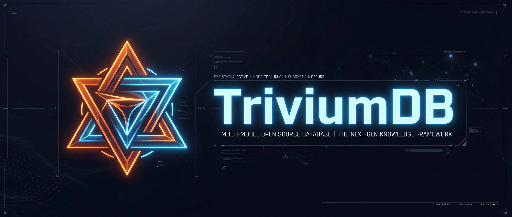
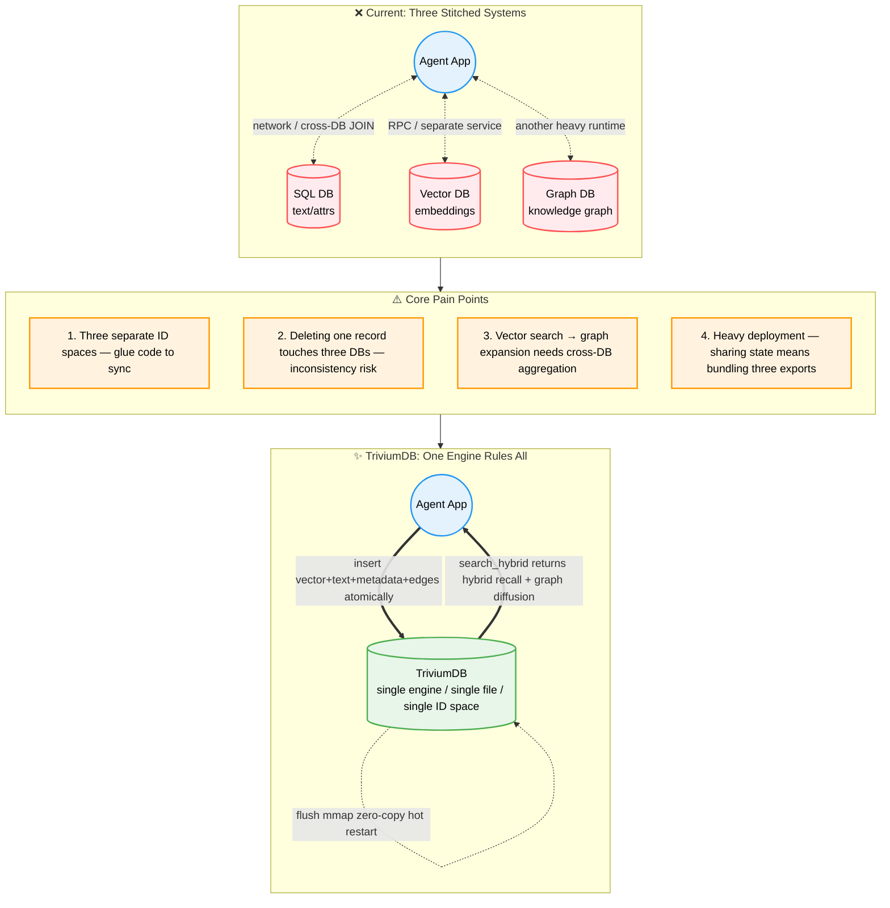

<br/><br/>

<div align="center">

<!-- Dynamic Typing Slogan -->
<a href="https://github.com/YoKONCy/TriviumDB">
  
</a>

<br/>

# TriviumDB

**Vector × Graph × Document — A Trinity AI-Native Embedded Database**

**Battle-tested in mission-critical, air-gapped environments.**

> _Trivium_: Latin for "the crossroads of three paths."

> TriviumDB provides in-process vector, graph, and document storage for Agent, RAG, and knowledge-graph applications. The host application manages database instances, queries, and persistence through Rust, Python, or Node.js APIs.

[](https://www.rust-lang.org/)
[](https://pypi.org/)
[](LICENSE)
[](https://arxiv.org/abs/2605.02171)

[**中文文档**](README.md) | **English**

</div>

---

## What is TriviumDB?

TriviumDB is an **embedded tri-model database engine** written in pure Rust, natively fusing **vector retrieval**, **property graph**, and **document-style metadata** within one storage kernel. Rom mode preserves single-`*.tdb` portability; default Mmap mode uses split sidecars protected by one generation protocol.

Our goal: **SQLite for AI applications.**

- 🧪 **DIY hybrid query pipelines** — TQL turns vector recall, property indexes, graph expansion, graph algorithms, paths, set algebra, iteration, aggregation, and reranking into freely composable operators, planned by a deterministic Cascades optimizer
- 📊 **Four persistent property indexes** — Hash / Ordered ART / Composite ART / Roaring Bitmap: equality, range, prefix, composite predicates, and low-cardinality set operations all index-accelerated
- 🧮 **Built-in graph algorithm library** — PageRank / WCC / SCC / K-Core / Articulation Points / Triangle Count / Local Clustering Coefficient / HITS / Harmonic Centrality / Node Similarity / Leiden / Betweenness / Degree / Label Propagation / SA-PPR callable inside queries, plus Weighted Dijkstra, Yen K-Shortest Paths, bounded PairSet, path, and set operators
- 🗃️ **Dual storage modes** — Rom keeps portable single-file `*.tdb`; Mmap separates vectors and published Payload into `.vec` and generation-scoped `.pld.<generation>` files
- ❄️ **Tiered Payload storage** — Published raw JSON stays in an mmap cold base, writes/updates enter an in-memory delta, and parsed values use a byte-bounded LRU cache; ANN/BQ/Exact candidate generation performs zero Payload parsing
- 🔗 **Node = everything** — Each node natively holds a dense vector, sparse text index, JSON metadata, and graph edges under one globally unique ID
- 🧠 **AI-native** — Optional hybrid recall (AC-automaton BM25 + dense vector) triggers graph spreading activation, with built-in cognitive pipelines (FISTA / DPP / PPR)
- 🛡️ **4-layer data safety** — Atomic replacement + WAL + dry-run transaction validation + mmap COW isolation; `.flush_ok` v3 binds `.tdb/.vec/.pld`, while prior-generation backups and an undo journal recover interrupted publication. Backups add disk I/O and temporary space; corrupted inputs still fail closed. See the [recovery protocol](docs/security.md#8-mmap-三文件一致性标记flush_ok-v3).
- 🐍 **Python / Node.js native** — `pip install` or `npm install`, MongoDB-style query syntax
- ⚡ **High-performance search** — rayon parallel brute-force (100% exact at small scale) + in-house ANN index **QuIVer**; current source uses training-free SM-L2 navigation and cosine reranking, activated at 209–834 nodes by vector workload
- 💾 **SSD-friendly** — Append-only WAL + background compaction + independent QuIVer persistence
- 🔒 **Shared read-only opens** — Multiple reader processes can query a completed generation under shared locks while writers retain exclusive WAL ownership
- 🧩 **Typed access capabilities** — Rust `DatabaseReader` hides mutation APIs at compile time while `DatabaseWriter` retains the complete embedded write surface
- 🔄 **Immutable generation switching** — `GenerationStore` atomically publishes current generations and uses cross-process runtime leases to protect safe reclamation without modifying read-only artifacts
- 🧰 **Multi-instance management (0.9.0-beta.1)** — A shared `ResourceRuntime` manages quotas, worker threads, and task slots, with instance diagnostics, controlled shutdown, and directory snapshots for applications running directly on a machine or inside containers

---

<div align="center">

<!-- Animated separator -->


<br/>

  
</div>

<br/>

## Why TriviumDB?

### The "Three-Database Split" Problem

Almost every AI application (Agent / RAG / recommendation) needs three data capabilities simultaneously, yet no existing engine natively supports all three:



### A Concrete Example

Suppose you're building an **AI conversation memory system** and the user says "I went to a café with Alice yesterday":

| Step              | Traditional 3-DB approach         | TriviumDB                            |
| ----------------- | --------------------------------- | ------------------------------------ |
| ① Store embedding | Call Qdrant API to write vector   | `db.insert(vec, payload)` — one step |
| ② Store metadata  | Call SQLite to write time, scene  | ↑ Same step — payload is JSON        |
| ③ Store relations | Call Neo4j: user→café→person      | `db.link(user, cafe, "went_to")`     |
| ④ Recall later    | 3 cross-DB queries + manual merge | `db.search(vec, expand_depth=2)`     |
| ⑤ Migrate data    | Export 3 files + write scripts    | Copy one `.tdb` in Rom, or one committed `.tdb/.vec/.pld/.flush_ok` generation in Mmap |

### Use Cases

| Scenario                         | How to use TriviumDB                                                                                                                   |
| -------------------------------- | -------------------------------------------------------------------------------------------------------------------------------------- |
| 🤖 **AI Agent long-term memory** | Store each conversation as a node (embedding + text + timestamp), link people/places/events, recall via vector match + graph diffusion |
| 🎮 **Game NPC cognition**        | NPC observations become vector nodes, inter-NPC relationships form a graph, memory retrieval generates contextual dialogue             |
| 📚 **Personal knowledge base**   | Markdown notes chunked into nodes, concepts linked manually or auto-linked, semantic search + knowledge graph navigation               |
| 🔬 **Recommendation system**     | Users and items as nodes, interactions as weighted edges, hybrid retrieval for "similar users liked + your social circle is watching"  |
| 🧬 **Bioinformatics**            | Gene/protein sequence embeddings + interaction networks, find similar sequences and trace metabolic pathways in one query              |

---

## QuIVer: ANN Graph Index

**QuIVer** (Quantized Index for Vector Retrieval) is TriviumDB's in-house ANN graph index. QuIVer combines **fast BQ graph construction, training-free SM-L2 navigation, and cosine reranking of original vectors**. Navigation uses two-bit codes and per-vector magnitudes to score reconstructed squared L2; recall and throughput depend on the workload, parameters, and reranking budget.

> 📖 [QuIVer architecture and configuration](docs/quiver.md) · [Benchmark guide](benches/README.md) · [0.9.0 changes](docs/changes/0.9.0.md)

> ⚠️ **Dimension guidance: keeping database vectors at or below 3072 dimensions is strongly recommended.** TriviumDB storage and exact BruteForce retrieval support higher dimensions, but QuIVer's BQ signature safety limit is 3072 dimensions. Above this limit, automatic QuIVer construction is disabled and search safely falls back to BruteForce; manual QuIVer construction returns an explicit error. Higher-dimensional databases remain usable, but do not receive QuIVer ANN acceleration and incur substantially higher memory and compute costs.

TriviumDB uses an **intelligent auto-routing dual engine**. The automatic threshold is `ceil(666,667 / dim)`, clamped to 209–834 nodes, so low-dimensional data stays exact longer while high-dimensional data switches to ANN earlier:

| Phase | Engine | Activation Condition | Characteristics |
|---|---|---|---|
| **Small-scale hot zone** | BruteForce | Below the dimension-dependent threshold, or QuIVer not ready | 100% exact recall, rayon multi-core |
| **Large-scale cold zone** | **QuIVer** | Dimension ≤ 3072 and the dynamic threshold is reached | BQ construction + SM-L2 navigation + original-vector cosine reranking |

For example, 384/768 dimensions trigger at 834 nodes, 1024 at 652, 1536 at 435, and 3072 at 218. Once the threshold is reached, the next eligible query or warmup builds the index.

### Key Design

**Hot/cold memory separation**: Original vectors remain in the cold vector pool and are read within the reranking budget. Hot memory includes retained BQ, SM codes and magnitudes, graph topology, ID/slot mappings, and thread workspaces. Measure savings for the evaluated configuration instead of reusing a historical fixed ratio.

> Mmap maps cold-vector pages on demand, with page faults fetching non-resident data. When a random-access working set exceeds physical memory, throughput and tail latency depend on page-cache hit rate, storage random-read capability, and reclaim pressure. QuIVer's hot index uses anonymous heap memory; capacity planning accounts separately for kernel heap, mmap residency, and OS page cache.

**Incremental graph maintenance**: Unlike traditional HNSW, QuIVer supports true incremental operations:

- ✅ **Incremental Insert**: New nodes inserted into the graph in real-time, no full rebuild
- ✅ **Incremental Delete**: Tombstone soft-delete, 25% degradation threshold triggers rebuild
- ✅ **Incremental Update**: soft_delete + incremental_insert, atomic replacement
- ✅ **Transaction-safe**: Separated timeline architecture — transaction commit cannot fail, QuIVer sync needs no rollback

**Independent persistence**: The graph is stored in `.tdb.quiver`. Loading a valid graph streams original vectors to restore default SM state without retaining a second full FP32 copy; cold-vector reads contribute to startup cost. Rebuild older indexes to adopt the current construction rules. Disconnected indexes follow the existing rebuild/reject policy; loading does not add repair edges.

---

## Research Frontier: TSNG Tri-Signal Navigation

**TSNG (Tri-Signal Navigation Graph)** is TriviumDB's hybrid-retrieval research track: a single query declares **vector, property, and graph signals** together, with `TsngWeights` controlling the three-way mix, producing a unified scored candidate set — "semantically similar, filter-compliant, and structurally reachable".

```rust
use triviumdb::tsng::{TsngQuery, TsngWeights, GraphSignalQuery};

let query = TsngQuery {
    vector: &query_embedding,
    payload_filter: Some(&Filter::eq("kind", "note")),   // property signal
    graph: Some(GraphSignalQuery {                        // graph signal
        anchor_id: seed_id,
        direction: ReachabilityDirection::Outgoing,
        labels: Some(vec!["cites".into()]),
        min_edge_weight: 0.2,
        max_hops: 2,
    }),
    top_k: 10,
    weights: TsngWeights { vector: 1.0, property: 1.0, graph: 0.5 },
    budget: Default::default(),
};

let result = db.search_tsng(&query, config)?;   // every hit carries the signal breakdown
```

Its research value lies in **measurable retrieval quality**:

- **Multiple execution strategies**: `search_tsng_post_filter` / `search_tsng_graph_union` / `search_tsng_industrial` — six hybrid-search access paths selected by budget and statistics
- **Explainable signals**: `TsngHit` returns `vector_similarity` / `property_signal` / `graph_signal` decompositions
- **Built-in ground truth**: `tsng_ground_truth` produces exact answers with Recall@K / NDCG@K quality metrics — paper-grade experiments are directly reproducible
- **Bounded budgets**: candidates, visited nodes, examined edges, and frontier size all fail closed

> TSNG is an **experimental research track**, with APIs evolving alongside research findings. TQL and the `search*` family provide the default query entry points.

```toml
# Enable Python bindings
maturin develop --features python
```

---

## Quick Start

### Installation

> 💡 TriviumDB core is written in Rust, but we've pre-compiled binaries for all platforms in the cloud — **no local build toolchain needed, instant install!**
>
> **Linux ARM64 / Kunpeng support:** TriviumDB supports Linux AArch64 with ARM NEON optimizations, ARM64 CI, Python manylinux ARM64 wheels, and a Node.js ARM64 addon build pipeline. It can run on Kunpeng server operating systems based on Linux AArch64.

### 🐍 Python Users

Recommended: use the blazing-fast [uv](https://github.com/astral-sh/uv) (millisecond install):

```bash
uv pip install triviumdb
```

Or traditional pip:

```bash
pip install triviumdb
```

### 🌐 Node.js / Frontend Users

Cross-platform package includes pre-compiled `*.node` native extensions with full TypeScript completions:

```bash
npm install triviumdb
# or
pnpm add triviumdb
```

### 🦀 Rust Native Users

Use as a library dependency:

```bash
cargo add triviumdb
```

`0.9.0` is the stable release: Rust, Python and Node.js share the native tri-model core, Cascades query planning, atomic transactions, resource budgets and controlled shutdown. Console v1 adds a host interface that reuses an already-open instance, alongside stronger file-group recovery, migration publication and Windows file-lock boundaries. Server and WebUI retain the nightly channel.

```bash
pip install "triviumdb==0.9.0"
npm install triviumdb@0.9.0
cargo add triviumdb@0.9.0
```

See the bilingual [0.9.0 release notes](docs/changes/0.9.0.md).

To add a management frontend to an embedded application, follow [Console host integration](docs/embedded-console.md) to reuse the same instance and file lock. The existing HTML still needs frontend-owned transport adaptation; the resource bundle declares that requirement and its CDN dependencies.

> 🧪 **Early Preview: HTTP Server Edition (nightly)** — TriviumDB's primary product form remains an **embedded database** (an in-process library, no deployment required). The optional `triviumdb-server` crate in this repository adds an HTTP shell (multi-client concurrent reads/writes, OCC, streaming NDJSON, etc.) and is currently in **nightly preview**: the protocol may change at any time, so it is for experimentation only — do not use it in production. See [Server Guide (nightly)](docs/server.md) (Chinese); all API and usage documentation remains authoritative for the embedded edition.

### 30-Second Demo

```python
import triviumdb

with triviumdb.TriviumDB("memory.tdb", dim=3) as db:
    id1 = db.insert([0.12, -0.45, 0.78], {"text": "Alice likes apples"})
    id2 = db.insert([0.08, -0.52, 0.81], {"text": "Bob gave Alice a box of apples"})
    db.link(id1, id2, label="caused_by", weight=0.95)

    results = db.search([0.10, -0.48, 0.80], top_k=5, expand_depth=2, min_score=0.6)
    for hit in results:
        print(f"[{hit.id}] score={hit.score:.3f} | {hit.payload}")
```

Batch ANN queries run concurrently on a shared Rust thread pool. Python releases the GIL for the entire batch, while Node.js returns a Promise without blocking the event loop. Only one database instance needs to open a path:

```python
batch_results = db.search_batch(
    [[0.10, -0.48, 0.80], [0.72, 0.11, -0.35]],
    top_k=10,
    parallelism=0,
)
```

```javascript
const batchResults = await db.searchBatch(queryVectors, 10, 0, 0.0)
```

`parallelism=0` selects concurrency automatically, with a maximum accepted value of 64. Outer result order always matches input query order. The batch API supports stateless queries only and rejects fatigue semantics.

> 📖 Full API reference, advanced usage, and Rust examples: **[API Reference](docs/api-reference.md)**

---

## Store Once, Query Many Ways

Every TriviumDB node can carry a **vector, JSON document, sparse text, and graph relationships**, accessed through one NodeId space and the query path that matches each question. Vector, document, and relationship mutations share transactions and the WAL. Separately registered sparse text is persisted by `flush()` or a writable handle's `close()`; applications should retain authoritative text and alias sources for rebuilding.

### TQL: A DIY-Composable Unified Query Language

**TQL (Trivium Query Language)** provides a **freely composable tri-modal execution pipeline**. Every `WITH` stage produces a named NodeSet; vectors, BM25/AC text recall, property indexes, graph expansion, graph algorithms, FISTA, DPP, NMF, paths, and set algebra can be chained according to application semantics, while Cascades picks a physical plan within budget:

```sql
-- Document query: filter JSON fields (property indexes skip full scans when hit)
FIND {type: "paper", year: {$gte: 2024}} RETURN * LIMIT 10

-- Graph query: bind an edge as a first-class value with direction, label, weight, and metadata
MATCH (author)-[relation:wrote]->(paper)
WHERE author.name == "Alice"
RETURN paper, relation

-- Locate vector anchors, then deterministically expand over incoming and outgoing edges
SEARCH VECTOR [0.12, -0.45, 0.78] TOP 5
EXPAND BOTH [:cites|related*1..2]
RETURN *

-- GraphFirst: constrain candidates by graph structure, then rank exactly by vector
MATCH (paper)-[:belongs_to]->(topic)
WHERE topic.name == "Database"
RANK paper BY VECTOR [0.12, -0.45, 0.78] TOP 10
RETURN paper

-- 🧪 DIY: vector seed → graph expansion → graph algorithm scoring → similarity filter → rerank
SEARCH VECTOR [0.12, -0.45, 0.78] TOP 100 AS seed
WITH seed
EXPAND seed [:cites*1..2] AS related
WITH related
pagerank related AS scored
WITH scored
WHERE similarity(scored) > 0.5
RETURN scored, similarity(scored) AS sim
ORDER BY sim DESC LIMIT 10

-- Text anchors → parameterized SA-PPR → DPP diversification
TEXT HYBRID "vector database" TOP 100 K1 1.2 B 0.75 AC_WEIGHT 1 AS text_seed
WITH text_seed
SA_PPR_CONFIG text_seed DEPTH 3 ALPHA 0.15 MAX_EDGES 64 MIN_WEIGHT 0 AS expanded
WITH expanded
DIVERSIFY expanded TOP 10 QUALITY_WEIGHT 1 AS diverse
WITH diverse
RETURN diverse, graph_score(diverse) AS relevance, diversity_score(diverse) AS diversity

-- Paths: bounded shortest paths from a semantic anchor
SEARCH VECTOR [1, 0] TOP 1 AS seed
WITH seed
SHORTEST_PATHS seed TO [42] LABEL cites AS route
WITH route
RETURN path(route) AS nodes, path_length(route) AS hops
```

A query can also use `TEXT BM25/AC/HYBRID` for sparse recall, `RESIDUAL` for FISTA residual recall, `DIVERSIFY` for DPP diversification, `TOPICS` for bounded NMF topic assignment, and `SA_PPR_CONFIG` for parameterized diffusion. `union` / `intersect` / `except`, fixed-point `iterate`, and `COUNT/SUM/AVG/MIN/MAX/COLLECT` remain composable with them. `text_score()`, `residual_score()`, `diversity_score()`, `topic()`, and `topic_score()` are first-class expressions. `EXPLAIN` exposes physical operators, estimated rows, temporary bytes, and budget slices.

`search_advanced()` uses `SearchConfig` to toggle hybrid text, FISTA, SA-PPR, DPP, and refractory fatigue inside the official fixed-order template. TQL reuses the underlying algorithms and allows developers to reorder stateless operators.

```python
# Prepared TQL: safely rebind business parameters on the same pipeline
prepared = db.prepare_tql('FIND {kind: "note"} RETURN $bonus + 1 AS score')
print(prepared.parameter_names())          # ['bonus']
rows = db.execute_prepared_tql(prepared, {"bonus": 4})
```

Rust, Python, and Node.js share the same TQL, Prepared queries, four property-index kinds, and first-class query values; the HTTP Server additionally exposes bounded neighborhood subgraphs, directional edge paging, batch node reads, and paths with per-hop edge details. See the **[TQL Reference](docs/tql-reference.md)** for the complete syntax.

### Graph and Hybrid Query Modes

| Query Mode | Core Semantics | Typical Uses |
| ---------- | -------------- | ------------ |
| **Graph pattern matching (MATCH)** | Match structure by node properties, edge direction, labels, and path patterns | Knowledge graph queries, relationship filtering, structured joins |
| **Reachability** | Run direction-, label-, and depth-aware BFS and return deterministic shortest paths with per-hop labels | Dependency chains, authorization paths, lineage, reachability analysis |
| **GraphFirst (MATCH + RANK)** | Produce valid anchors from graph structure, then compute exact vector Top-K within that set | “Find the most similar objects only within this relationship constraint” |
| **Vector + structural expansion (SEARCH + EXPAND)** | Locate semantic anchors, then collect structural candidates through `OUTGOING`, `INCOMING`, or `BOTH` edges | Add upstream or downstream context after semantic retrieval |
| **SA-PPR graph diffusion** | Propagate relevance energy from vector/text anchors over weighted edges, with optional inhibition, fatigue, and restart | Agent associative memory, RAG context expansion, recommendation recall |
| **Text & cognitive operators (TQL)** | Independently compose `TEXT BM25/AC/HYBRID`, `RESIDUAL`, `SA_PPR_CONFIG`, `DIVERSIFY`, and `TOPICS`, with first-class scores | Custom RAG, agent memory, topic analysis, diversified retrieval |
| **Hybrid retrieval (`search_hybrid`)** | Combine Aho-Corasick, BM25 sparse text, and dense vectors before graph diffusion and reranking | Production retrieval balancing exact terminology and semantic similarity |
| **Graph algorithm pipelines (WITH)** | `pagerank` / `wcc` / `degree` / `leiden` / `label_propagation` / `sa_ppr` score NodeSets; `graph_score()` projects results | Influence ranking, community detection, graph analytics |
| **Path queries (ALL_PATHS / SHORTEST_PATHS)** | Bounded all-paths and batch shortest paths with label sequences, forbidden nodes, and path aggregation | Lineage tracing, dependency analysis, authorization chains |
| **Set algebra (UNION / INTERSECT / EXCEPT)** | Deterministic union / intersection / difference over multi-way candidate NodeSets | Multi-way recall fusion, candidate convergence |
| **Prepared TQL** | Parameterized queries; missing / extra / invalid parameters fail closed | Safe reuse of high-frequency business queries |

**Reachability answers “is it structurally reachable?”**, **GraphFirst answers “which item is most similar within this structural constraint?”**, and **SA-PPR answers “which related nodes deserve more relevance?”** Applications can choose among them over the same `.tdb` data or combine document, graph, and vector conditions in one TQL query.

---

## Core Features

| Feature                          | Description                                                                                                                |
| -------------------------------- | -------------------------------------------------------------------------------------------------------------------------- |
| 🧪 **DIY hybrid queries**        | TQL `WITH`: freely compose vectors / BM25 / AC / properties / graph expansion / FISTA / DPP / NMF / paths / sets / aggregation, with deterministic Cascades and transparent `EXPLAIN` |
| 📊 **Four property indexes**     | Hash / Ordered ART / Composite ART / Roaring Bitmap persisted to `.pidx`; equality / range / prefix / composite / low-cardinality set operations all accelerated |
| 🧮 **Built-in graph algorithms** | PageRank / WCC / Leiden / Betweenness / Degree / Label Propagation / SA-PPR callable inside queries                        |
| 🛰️ **Paths & set algebra**      | `ALL_PATHS` / `SHORTEST_PATHS` / `UNION` / `INTERSECT` / `EXCEPT` / `ITERATE`, plus Prepared TQL across three languages     |
| 🔍 **Hybrid retrieval**          | Vector anchor → Top-K → Graph spreading activation → Final ranking                                                         |
| 🧠 **Cognitive pipeline**        | `search_advanced()` is the toggleable fixed-order official template; TQL freely composes stateless FISTA / parameterized SA-PPR / DPP / NMF, while refractory fatigue remains stateful API-only |
| 🔌 **Hook system**               | 6-stage pipeline injection points with C/C++ FFI dynamic library plugin support                                            |
| 📦 **O(1) operations**           | FreeList tombstone reuse + Reverse Hash Net for O(1) reverse edge lookup                                                   |
| ⚡ **QuIVer ANN index**          | BQ graph construction + default SM-L2 navigation + cosine reranking for f32/f16 embeddings, hot/cold separation, incremental maintenance         |
| 💾 **Dual storage**              | Mmap (zero-copy cold start) / Rom (SQLite-style single-file portability)                                                   |
| 🛡️ **4-layer disaster recovery** | WAL + atomic replacement + dry-run validation + OS-level COW isolation                                                     |
| 🔄 **Zero-cost transactions**    | `begin_tx()` with pre-validation; errors never pollute memory state                                                        |
| 🔎 **Advanced filtering**        | MongoDB-style operators: `$eq/$ne/$gt/$lt/$in/$and/$or/$startsWith/$contains` + Parallel Bit-Tag Array                     |
| 📝 **Graph queries**             | Built-in Cypher-like query engine: `MATCH (a)-[:knows]->(b) WHERE b.age > 18 RETURN b`                                     |
| 🐍 **Python native**             | PyO3 bindings, `pip install` then `import triviumdb`                                                                       |
| 🌐 **Node.js native**            | napi-rs bindings, `npm install` then `require('triviumdb')`                                                                |
| 🧰 **Shared resources & diagnostics** | 0.9.0-beta.1: database quotas, protected maintenance memory, thread/task limits, available budgets, and instance/maintenance status |
| 📸 **Controlled shutdown & snapshots** | 0.9.0-beta.1: shutdown requests, bounded waits, consistent snapshots, verification, and restore to a new directory across Rust/Python/Node |

Floating-point embeddings use cosine retrieval and QuIVer acceleration. Packed `u64` SimHash fingerprints use exact Hamming retrieval with their original bit patterns.

> 📖 Deep dive into architecture and technical details: **[Feature Details](docs/features.md)**

---

## Multi-Instance Resources and State Transfer

These capabilities are available starting with `0.9.0-beta.1`, with aligned Rust, Python, and Node.js APIs.

Each tenant, session, or Agent can use an independent database while sharing one `ResourceRuntime`. The runtime accounts for database quotas and temporary workspaces and manages compute workers, foreground tasks, and maintenance tasks. Applications running directly on a machine or inside containers use the same embedded APIs.

- **Shared resources**: configure a total memory budget, protected maintenance memory, worker limits, and foreground root-task slots. Operations undergo admission checks before starting work.
- **Instance diagnostics**: use `runtime.stats()` for shared accounting and available budgets, and `db.instance_stats()` for the database quota, estimated memory, active-operation count, and maintenance status.
- **Controlled shutdown**: `request_shutdown()` stops new operations and drains existing work; `close_timeout()` bounds the caller's wait, and `shutdown_status()` reports progress.
- **Consistent snapshots**: `create_snapshot()` captures a complete database directory, `verify_snapshot()` checks its artifacts, and `restore_snapshot()` restores it into a new directory.

```python
from triviumdb import ResourceRuntime, TriviumDB

runtime = ResourceRuntime(
    memory_limit_mb=256, maintenance_memory_limit_mb=32,
    max_threads=4, max_active_tasks=8,
)
first = TriviumDB("agent-a.tdb", dim=3, memory_limit_mb=64, runtime=runtime)
second = TriviumDB("agent-b.tdb", dim=3, memory_limit_mb=64, runtime=runtime)
try:
    first.insert([1.0, 0.0, 0.0], {"text": "会话记忆"})
    print(runtime.stats())
    print(first.instance_stats())
finally:
    first.close()
    second.close()
```

Memory admission accounts for declared quotas and integrated workspace reservations. Process or container sizing also includes mmap residency, page cache, thread stacks, and language-runtime overhead. Python budget exceptions and Node `QueueFull` errors expose `resource`, `requested`, `used`, and `limit` for throttling, backoff, and instance eviction decisions.

In `0.9.0-beta.2`, successful close releases file handles, memory mappings, database Hooks, and quota reservations. Group commits restore their state after unwinding. Rust data reads and `set_hook()` return `Result`; Python and Node raise closed-database errors after close. See [version changes](docs/changes/0.9.0-beta.2.md#生命周期与-rust-api-迁移) for migration details (Chinese).

See [Shared Resources and Diagnostics](docs/resource-runtime.md) and [Shutdown, Snapshots, and Restore](docs/lifecycle-snapshots.md) (Chinese).

---

## Comparison with Existing Solutions

| Dimension            | SQLite       | pgvector      | Kùzu           | Qdrant           | Neo4j              | SurrealDB       | LanceDB        | **TriviumDB**                                   |
| -------------------- | ------------ | ------------- | -------------- | ---------------- | ------------------ | --------------- | -------------- | ----------------------------------------------- |
| Concurrent multi-writer | ⚠️ Single-writer (WAL) | ✅ MVCC multi-writer | ⚠️ Single-process writer | ✅ Server-side concurrent writes | ✅ Concurrent tx writes | ✅ Distributed write nodes | ✅ MVCC+OCC concurrent writes | ⚠️ Single-writer + shared-read/immutable generations |
| Document data        | ✅ SQL       | ✅ SQL+JSONB  | ⚠️ Fixed table schema | ❌ Filter only | ⚠️ Property KV    | ✅ SurrealQL    | ✅ Arrow schema | ✅ Free JSON + full `$op` suite                 |
| Vector search        | ⚠️ Extension | ✅ HNSW/IVFFlat | ✅ HNSW ext.  | ✅ HNSW          | ✅ Native HNSW     | ✅ MTree/HNSW   | ✅ IVF+quant    | ✅ QuIVer (BQ construction + SM-L2)             |
| Graph traversal      | ⚠️ JOIN      | ⚠️ Recursive CTE | ✅ Cypher    | ❌ No graph ops  | ✅ Cypher          | ✅ Graph        | ❌ No graph ops | ✅ Native adjacency + `.gidx`                   |
| Embedded portable storage | ✅ One file  | ❌ PG server  | ✅ One file     | ⚠️ Memory/dir embedded | ❌ JVM        | ✅ Switchable   | ⚠️ Dir embedded | ✅ Single `.tdb` in Rom / committed file set in Mmap |
| Hybrid query freedom | ❌           | ⚠️ SQL JOINs  | ⚠️ Filtered ANN | ❌ Vector-only  | ⚠️ SEARCH-filtered | ⚠️ Manual       | ⚠️ Vec+FTS+SQL | ✅ WITH pipeline composition                    |
| Property index suite | ✅ B+Tree    | ✅ B/GIN/BRIN | ⚠️ In-schema indexes | ⚠️ Payload indexes | ⚠️ Label+prop Range/Text | ⚠️ Unique/FTS/ANN-centric | ⚠️ Scalar idx | ✅ Hash / ART / Composite / Bitmap              |
| Query optimizer      | ✅           | ✅            | ✅              | ❌ API-call based | ✅                 | ⚠️ EXPLAIN limited | ⚠️ DataFusion SQL | ✅ Cascades + EXPLAIN                        |
| Graph algorithm library | ❌        | ⚠️ External ext. | ⚠️ algo extension | ❌            | ⚠️ GDS plugin      | ❌             | ❌             | ✅ 7 algorithms in-query                        |
| Path / set queries   | ⚠️ Recursive CTE | ⚠️ Recursive CTE | ✅ `*SHORTEST` + UNION | ❌ | ✅ shortestPath | ⚠️ No path primitives | ❌  | ✅ ALL/SHORTEST_PATHS + set algebra        |
| Zero dependencies    | ✅           | ✅            | ✅              | ✅               | ❌ JVM             | ❌ RocksDB      | ⚠️ Arrow/object-store ecosystem | ✅ Pure Rust                    |

> **Concurrent multi-writer** is TriviumDB's current known weakness: the Writer owns the write path through a process-level exclusive file lock, concurrent reads rely on ReadOnly shared locks, and lock-free cross-process reads rely on immutable published generations. This is a common trade-off among embedded engines — SQLite (single writer under WAL) and the original Kùzu (single-process writes) make the same choice. For workloads that genuinely need high-concurrency multi-writer access, prefer a server-based (Qdrant/Neo4j/pgvector), distributed (SurrealDB), or MVCC table-format (LanceDB) solution.
>
> Comparison verified against public docs and official repositories as of 2026-08: pgvector is a PostgreSQL C extension (v0.8.2, HNSW/IVFFlat with iterative-scan filtering); Qdrant offers an embedded local mode (`QdrantClient(":memory:")` or `path=`, stored as a directory rather than a single file) plus the Qdrant Edge embedded library for Rust/Python; LanceDB is a Rust-core embedded multimodal lakehouse (vector+FTS+SQL, no graph traversal); the main Kùzu repository was archived in Oct 2025 (the team joined Apple; 0.11.3 is the final release), and its Cypher supports `*SHORTEST` recursive paths plus the algo extension; Neo4j has shipped a native vector index since 5.13 (Lucene HNSW, with in-index filtering via the Cypher 25 `SEARCH` clause); SurrealDB vector indexes use MTree/HNSW; SQLite can emulate some capabilities via the sqlite-vec extension and recursive CTEs. **"Hybrid query freedom"** means being able to compose vectors, property filters, graph traversals, graph algorithms, paths, and set operations as pipeline operators handed to a unified optimizer within a single query — exactly what the TQL `WITH` pipeline + Cascades is built for.

---

## Project Structure

```
TriviumDB/
├── src/
│   ├── lib.rs              # Library entry + public API
│   ├── database/           # Core database module (v0.7.0 modular refactor)
│   │   ├── mod.rs          # Database struct, CRUD, lifecycle management
│   │   ├── config.rs       # StorageMode / Config / SearchConfig
│   │   ├── lifecycle.rs    # 受控关闭、实例诊断与关闭状态
│   │   ├── pipeline.rs     # Hybrid search pipeline (L0-L9 + 6 hook injection points)
│   │   └── transaction.rs  # Transaction system (TxOp / WAL replay + QuIVer separated timeline)
│   ├── hook.rs             # 🔌 Hook extension system (SearchHook trait + FFI dynamic library)
│   ├── cognitive.rs        # Cognitive operators (FISTA / DPP / NMF)
│   ├── node.rs             # Node / Edge / SearchHit data structures
│   ├── vector.rs           # VectorType Trait (f32 / f16 / u64)
│   ├── filter.rs           # Advanced filter engine ($gt/$lt/$in/$and/$or/$startsWith/$contains)
│   ├── tsng.rs             # 🔬 TSNG tri-signal hybrid retrieval research track (6 access paths + ground truth)
│   ├── error.rs            # Unified error types (incl. ApiMigrationRequired / sidecar version gates)
│   ├── resources.rs        # 共享配额、工作线程池与资源统计
│   ├── query/              # 🧪 TQL query subsystem (v0.8 query engine refactor)
│   │   ├── tql_lexer.rs    #   Lexer (tokens / parameters / positional diagnostics)
│   │   ├── tql_parser.rs   #   Recursive-descent parser + scope & semantic validation
│   │   ├── tql_ast.rs      #   Query / pipeline / expression / aggregation / path AST
│   │   ├── cascades.rs     #   Cascades optimizer (memo + costing + budget slicing)
│   │   ├── pipeline.rs     #   NodeSet physical operators (algorithms / paths / sets / iteration)
│   │   ├── tql_executor.rs #   First-class value execution, aggregation & projection
│   │   └── tql_prepared.rs #   Prepared TQL strict parameter binding
│   ├── storage/
│   │   ├── memtable.rs     # In-memory workspace (SoA vector pool + HashMap + QuIVer integration)
│   │   ├── wal.rs          # Write-Ahead Log (crash recovery)
│   │   ├── file_format.rs  # .tdb single-file reader/writer (BQ metadata + QuIVer persistence)
│   │   ├── vec_pool.rs     # Layered vector pool (mmap base + delta incremental)
│   │   ├── snapshot.rs     # 代际清单与快照入口
│   │   ├── snapshot/      # 目录快照创建、校验与恢复
│   │   └── compaction.rs   # 共享计时调度、压实与维护诊断
│   ├── index/
│   │   ├── brute_force.rs  # rayon parallel exact search
│   │   ├── bq.rs           # BQ binary quantization signatures (QuIVer foundation)
│   │   ├── quiver.rs       # 🚀 BQ 构图、默认 SM-L2 导航与冷热分离
│   │   ├── property.rs     # 📊 Four property indexes (Hash / Ordered ART / Composite ART / Roaring Bitmap)
│   │   ├── text.rs         # 📝 TextIndex (Aho-Corasick + BM25 2-Gram persistence)
│   │   └── graph_blocks.rs # 🔗 Business graph block index .gidx (edge blocks / in-edge / label directories)
│   ├── graph/
│   │   ├── traversal.rs    # PPR graph diffusion (Spreading Activation)
│   │   ├── reachability.rs # Deterministic reachability (direction / labels / depth / budget)
│   │   ├── pathfinding.rs  # Bounded ALL_PATHS / batch shortest paths
│   │   └── leiden.rs       # Leiden community detection
│   └── bindings/           # FFI binding layer
│       ├── mod.rs          # Unified entry (feature-gated)
│       ├── python.rs       # PyO3 bindings
│       └── nodejs.rs       # napi-rs bindings
├── crates/
│   ├── triviumdb-cli/      # 🖥️ CLI & TUI tool (command `tdb`)
│   │   ├── Cargo.toml
│   │   ├── README.md
│   │   └── src/
│   │       ├── main.rs             # clap argument parsing + mode dispatch
│   │       ├── db_handle.rs        # DbHandle dtype dynamic dispatch (dispatch! macro)
│   │       ├── formatter.rs        # table / json / csv output formatting
│   │       ├── tql_highlight.rs    # TQL syntax highlighting (REPL ANSI + TUI Span)
│   │       ├── config.rs           # ~/.triviumdb.toml configuration loading
│   │       ├── commands/           # Non-interactive subcommands (info/exec/export/import/repair/compact)
│   │       ├── repl/               # REPL mode (rustyline + Tab completion + multi-line input)
│   │       └── tui/                # TUI mode (ratatui + crossterm full-screen visualization)
│   └── triviumdb-server/   # 🌐 HTTP Server (concurrent reads, Writer Actor, OCC, Group Commit)
├── benches/                # Benchmark suites (queries / index & graph baselines / memory pressure / TSNG / Cohere1M)
├── tests/
│   ├── unit/               # Unit tests (~311 cases)
│   ├── proptest_core.rs    # Property-based tests (~2650 random cases)
│   ├── proptest_query.rs   # TQL parser property tests
│   ├── public_api_alignment.rs  # Three-language public API alignment gate
│   └── ...                 # Integration tests (concurrency/recovery/security/stress/pipeline differential/graph algorithms)
├── docs/
│   ├── api-reference.md    # Full API reference
│   ├── features.md         # Feature details
│   ├── best-practices.md   # Best practices guide
│   ├── resource-runtime.md # 多实例共享资源与诊断
│   ├── lifecycle-snapshots.md # 实例关闭、快照与恢复
│   ├── hook-guide.md       # Hook development guide (C++ FFI / Rust Hook)
│   ├── tql-reference.md    # TQL query language reference
│   ├── testing.md          # Testing practices
│   └── security.md         # Security design notes
├── Cargo.toml
├── pyproject.toml          # Maturin build config
└── README.md
```

---

## Roadmap

### v0.1 — Core Engine MVP ✅

- [x] Node / Edge data structures + in-memory MemTable + BruteForce vector search
- [x] Single-file `.tdb` serialization + `insert` / `link` / `search` / `delete` API

### v0.2 — Persistence & Ecosystem ✅

- [x] WAL crash recovery + background compaction + mmap zero-copy
- [x] PyO3 Python bindings + rayon parallel scan + advanced payload filtering

### v0.3 — Performance & Cross-Platform ✅

- [x] Node.js bindings (napi-rs)
- [x] AVX2 + FMA SIMD accelerated cosine similarity

### v0.4 — Cognitive Pipeline + BQ Index ✅

- [x] Mmap / Rom dual engine + dry-run transaction validation
- [x] Cognitive retrieval pipeline (FISTA / PPR / DPP)
- [x] BQ binary quantization index (auto-activate + auto-rebuild)

### v0.5 — 10M-Scale Architecture + Hook System ✅

- [x] Parallel Bit-Tag Array hardware-accelerated bloom filtering + Zero-Ghost tombstone reuse
- [x] O(1) Reverse Hash Net reverse edge lookup
- [x] 6-stage pipeline hook injection + FFI dynamic library plugins
- [x] CI/CD pipeline + ASan / TSan / Miri + LibFuzzer; see [test scope and limitations](docs/testing.md)

### v0.6 — TQL Query Language + Cross-Arch ✅

- [x] TQL unified query language (MATCH graph / FIND document / SEARCH vector)
- [x] TQL DML write operations (CREATE / SET / DELETE / DETACH DELETE)
- [x] Property secondary index (O(1) inverted lookup + TQL auto-acceleration)
- [x] ARM NEON SIMD adaptation + cross-platform CI (Apple Silicon / Linux ARM64)

### v0.7 — QuIVer SOTA ANN Index ✅

- [x] In-house **QuIVer** ANN graph index (BQ signatures + Vamana graph + hot/cold separation)
- [x] Incremental graph maintenance: Insert / Delete (Tombstone) / Update — no full rebuild
- [x] QuIVer independent persistence (`.tdb.quiver` file, POD memcpy serialization)
- [x] Transaction-safe separated timeline architecture (Phase 5 QuIVer Sync)
- [x] CLI tool `triviumdb-cli` (command `tdb`): non-interactive commands + REPL (Tab completion / syntax highlighting / multi-line input) + config file
- [x] Database visualization: terminal TUI (`tdb ui`, force-directed graph layout / k-hop expand / vector search playground)

### v0.8 — DIY Hybrid Queries & Engineering Hardening ✅ (Current)

- [x] **Unified TQL query system**: `FIND` / `MATCH` / `SEARCH`, composable `WITH`, Prepared parameters, expressions/aggregates/paths/set algebra, scientific notation, and atomic `SET VECTOR`
- [x] **Bounded Cascades and graph computing**: deterministic statistics-aware physical plans, built-in graph algorithms, and estimated/actual metrics through `EXPLAIN ANALYZE`
- [x] **Complete persistent index suite**: Hash / Ordered ART / Composite ART / Bitmap, graph blocks, AC+BM25, and QuIVer sidecars; dynamic QuIVer thresholds select between 209 and 834 nodes by vector workload
- [x] **Production-grade storage and safety**: `.flush_ok` v3 binds `.tdb/.vec/.pld` generation, sizes, and CRCs; no production-reachable panic, byte-level zero writes in ReadOnly/Immutable modes, WAL/generation atomicity, fail-closed query/traversal/memory/Payload budgets, and bounded real fault injection
- [x] **Payload tiering phase 1**: generation-scoped `.pld` mmap raw base, in-memory delta/tombstones, bounded LRU parsed cache, late materialization, `ColdPayloadScan`, and cross-language cache configuration
- [x] **Aligned Rust/Python/Node capabilities**: first-class TQL values, four property indexes, Prepared TQL, six-stage Hooks, FFI ABI v2, and explicit migration errors instead of silent legacy compatibility
- [x] **Multi-instance management (0.9.0-beta.1)**: shared budgets and worker pools, protected maintenance memory, instance/maintenance diagnostics, controlled shutdown, consistent snapshots and restore, with aligned APIs and type declarations
- [x] **Tools and nightly Server**: CLI/REPL/TUI plus a dependency-isolated HTTP Server with Writer Actor, Group Commit, OCC/idempotency, health supervision, index management, NDJSON import, binary vectors, and cross-platform releases


---

## Design Philosophy

1. **Trinity atomicity** — One `u64` ID maps to vector, payload, and edge table simultaneously. Insert atomic, delete atomic, never inconsistent.
2. **Embedded-first** — The database runs as a library inside the host process. Rust, Python, and Node.js APIs manage data and instance lifecycles.
3. **Auto performance routing** — Uses an approximately 0.667M-component workload to select a dynamic threshold between 209 and 834 nodes; exact BruteForce runs below it and QuIVer builds automatically once reached.
4. **Predictable performance** — Sequential I/O only (WAL append + compaction sequential rewrite). SSD-safe.
5. **Index as acceleration layer** — QuIVer is disposable derived data (`.tdb.quiver` file); auto-rebuilds on first query if missing.
6. **Rust safety contracts** — mmap, SIMD, raw-pointer, and manual `Send/Sync` paths are reviewed for length, alignment, lifetime, and concurrency requirements, with ASan, TSan, and Miri validation. See [security design](docs/security.md) and [testing scope](docs/testing.md).
7. **Zero-panic policy** — No `panic!` / `unreachable!()` in the engine. Thousands of test cases (unit / property / fuzz / mutation / three-language public API alignment), with an enforced 80% line-coverage CI gate (see coverage artifacts for measured values).

---

## 📖 Documentation

| Document                                     | Description                                                      |
| -------------------------------------------- | ---------------------------------------------------------------- |
| **[LLM Project Index](llms.txt)**            | Product overview, capabilities, use cases, and documentation links |
| **[API Reference](docs/api-reference.md)**   | Full Python / Node.js / Rust API, parameters, return types       |
| **[Feature Details](docs/features.md)**      | Architecture, storage engine, indexing strategy, crash recovery  |
| **[Best Practices](docs/best-practices.md)** | Data modeling, performance tuning, Hook usage guide              |
| **[Shared Resources and Diagnostics](docs/resource-runtime.md)** | Quotas, maintenance memory, worker pools, available budgets, and structured errors |
| **[Shutdown, Snapshots, and Restore](docs/lifecycle-snapshots.md)** | Shutdown requests, bounded waits, consistent snapshots, verification, and directory restore |
| **[TQL Reference](docs/tql-reference.md)**   | MATCH / FIND / SEARCH syntax, DML operations, property index     |
| **[Hook Guide](docs/hook-guide.md)**         | C/C++ FFI plugin development, Rust Hook implementation           |
| **[Testing Practices](docs/testing.md)**     | 4-layer testing, property testing, mutation testing, coverage    |
| **[Security Design](docs/security.md)**      | Concurrency safety, data integrity, unsafe audit, FFI boundaries |
| **[CLI Tool Guide](crates/triviumdb-cli/README.md)** | `tdb` command-line tool installation, usage, REPL/TUI modes, config file |
| **[Server Guide (nightly)](docs/server.md)**  | HTTP server preview: concurrency model, OCC, idempotency, metrics & limits |

---

## Academic References

TriviumDB's cognitive retrieval pipeline implements the following academic works (all independent Rust implementations from original papers):

1. **FISTA**: Beck & Teboulle, 2009, _SIAM J. Imaging Sciences_
2. **DPP**: Kulesza & Taskar, 2012, _Foundations and Trends in ML_
3. **SA-PPR**: finite-depth Spreading Activation with Personalized Restart
4. **Spreading Activation**: Anderson, 1983, _The Architecture of Cognition_
5. **BM25**: Robertson & Zaragoza, 2009
6. **Vamana Graph**: Subramanya et al., 2019, _DiskANN_, NeurIPS 2019
7. **Binary Quantization**: Gong et al., 2012, _Iterative Quantization_, CVPR

In-house data structures and algorithms:

- **QuIVer** — ANN graph index with fast BQ construction, training-free SM-L2 navigation, and cosine reranking
- **TSNG** (Tri-Signal Navigation Graph) — tri-signal (vector / property / graph) hybrid retrieval research track with multiple access-path strategies and exact ground-truth evaluation
- **Parallel Bit-Tag Array** — Bloom-filter-inspired JSON fast filtering
- **Reverse Hash Net** — O(1) reverse edge lookup hash index
- **Zero-Ghost Node** — FreeList-based tombstone reuse
- **Separated Timeline Architecture** — QuIVer transaction safety via infallible apply

### 📝 Citing QuIVer

QuIVer research reference:

```bibtex
@article{quiver2026,
  title   = {QuIVer: Rethinking ANN Graph Topology via Training-Free Binary Quantization},
  author  = {Xiao, Wenxuan and Wang, Zhiyou and Li, Chengcheng},
  journal = {arXiv preprint arXiv:2605.02171},
  year    = {2026},
  url     = {https://arxiv.org/abs/2605.02171}
}
```

---

## License

Apache-2.0

**Creator**: [YoKONCy](https://github.com/YoKONCy)

---

## Community

This project is linked to and recognizes the [LINUX DO community](https://linux.do/).

<br/>

## 🌟 Star History

[](https://star-history.com/#YoKONCy/TriviumDB&Date)

<br/>

<div align="center">
  
</div>
