# TriviumDB 支持特性详解

> TriviumDB `0.9.0-beta.4` 的架构、核心能力与技术实现。版本记录见[变更说明](changes/0.9.0-beta.4.md)。

## 当前能力快照

- **持久化索引**：QuIVer ANN、Hash、Ordered ART、Composite ART、Roaring Bitmap、AC+BM25 TextIndex、业务图块索引。
- **自由 DIY 混合查询**：TQL 提供可编排执行管线。开发者可将向量召回、BM25/AC 文本召回、属性过滤、图扩展、图算法、FISTA 残差召回、DPP 多样化、NMF 主题分配、路径、集合代数、迭代、聚合和重排按业务语义自由串联，并由 Cascades 在预算内选择物理计划。
- **双形态认知检索**：`search_advanced()` 保留组件可开关、顺序固定的官方模板；TQL 复用相同 BM25、AC、FISTA、DPP、NMF 与图扩散底层实现，允许自由编排无状态组件。疲劳不应期仍仅属于有状态 API。
- **统一查询底座**：TQL Parser/AST、WITH 管线、Cascades 优化、Prepared TQL、Path 与一等值结果共同支撑上述自由组合；数字字面量支持科学计数法，MATCH 属性/ID 投影按实际值去重，`SET VECTOR` 通过原子 mutation 更新向量。
- **统一返回与匹配写入**：MATCH、FIND、WITH 和单跳具名边共享分组、聚合、去重、别名排序与分页；COUNT 按表达式值计数。多字段 SET 按节点合并，CREATE 按完整匹配集建立独立变量作用域，SET VECTOR 保留完整 u64 整数并按 dtype 准入。
- **系统保证**：确定性执行、查询/遍历/内存/并行预算、ReadOnly/Immutable 零写、generation 原子发布。
- **事实绑定与类型检查**：`.tdb` v10 保存 dtype、元素宽度和头部 CRC；QuIVer 元数据 v2 绑定主文件、向量内容及活跃 ID/slot，图与属性 sidecar 在采用前检查当前事实。
- **查询物化准入**：TQL、精确与 GraphFirst 检索、可达性及子图在复制 Payload、向量、边和 Metadata 前申请工作区；DML 匹配使用实例内存预算，返回阶段按实际求值列计量。
- **跨语言能力**：Rust、Python、Node 同步提供四类属性索引管理、Prepared TQL、一等查询值和存储格式观测。
- **多实例运行管理**：共享 `ResourceRuntime` 统一登记数据库配额和工作区，管理工作线程及前台/维护任务名额；共享与实例诊断提供预算余额、维护延期和故障详情。
- **生命周期与状态迁移**：关闭请求、排空、限时等待、目录快照、校验及恢复，Rust/Python/Node 接口同步提供。
- **资源释放与恢复**：关闭完成时释放数据库文件、映射和 Hook；WAL 按帧流式回放，加载后回收干净向量页，支持持有关闭对象时复用数据库路径。
- **文本重建与文件组发布**：三端提供完整正文、关键词集合重建接口；主数据与文本、属性、图索引共同参与检查点发布和中断恢复。
- **严格升级策略**：历史静默 API 已移除；误用返回迁移错误。主文件保留有限读取窗口，可重建 sidecar 独立版本化。

---

## 目录

- [架构总览](#架构总览)
- [三位一体数据模型](#三位一体数据模型)
- [存储引擎与双模式切换](#存储引擎与双模式切换)
- [向量索引策略](#向量索引策略)
- [图谱扩散检索](#图谱扩散检索)
- [认知检索管线](#认知检索管线)
- [TQL 统一查询语言](#tql-统一查询语言)
- [持久化属性索引体系](#持久化属性索引体系)
- [崩溃恢复机制](#崩溃恢复机制)
- [多实例资源与生命周期](#多实例资源与生命周期)
- [并发安全与零开销事务](#并发安全与零开销事务)
- [Python 与 Node.js 绑定](#python-绑定架构)
- [跨架构 SIMD 加速](#跨架构-simd-加速)

---

## 架构总览

TriviumDB 采用分层架构，各层职责明确：

```mermaid
flowchart TD
    classDef layer fill:#fafafa,stroke:#e0e0e0,stroke-width:2px,color:#333;
    classDef module fill:#e3f2fd,stroke:#2196f3,stroke-width:1px,color:#000;
    classDef math fill:#f3e5f5,stroke:#9c27b0,stroke-width:1px,color:#000;
    classDef storage fill:#e8f5e9,stroke:#4caf50,stroke-width:1px,color:#000;

    subgraph Layer1 ["🌐 用户 API 层"]
        direction LR
        API1[Python binding]:::module
        API2[Node.js binding]:::module
        API3[Rust pub API]:::module
        API4["CLI / TUI (tdb)"]:::module
    end
    Layer1:::layer

    subgraph Layer2 ["⚙️ 数据库核心层 (Database)"]
        direction LR
        C1[事务控制 Dry-Run]:::module
        C2[WAL 编排]:::module
        C3[共享资源与维护调度]:::module
        C4[实例生命周期与快照]:::module
    end
    Layer2:::layer

    subgraph Layer3 ["🚀 引擎与执行层"]
        direction LR
        E1["向量索引\n(BruteForce / QuIVer)"]:::module
        E2["图谱遍历\n(Spreading Activation)"]:::module
        E3["TQL 查询引擎\n(Parser / Cascades / Pipeline)"]:::module
    end
    Layer3:::layer

    subgraph Layer4 ["🧠 认知管线层 (cognitive.rs)"]
        direction LR
        M1[FISTA 残差寻隐]:::math
        M2[DPP 多样性采样]:::math
        M3[NMF 语义矩阵分解]:::math
    end
    Layer4:::layer

    subgraph Layer5 ["🗂️ 内存工作区 (MemTable)"]
        direction LR
        M_VEC["SoA 向量池\n(基础层 mmap + 增量层 Vec)"]:::module
        M_PAY["HashMap\n(Payload 元数据)"]:::module
        M_EDGE["图谱邻接表 + 派生目录\n(出边 / 入边 / Label)"]:::module
    end
    Layer5:::layer

    subgraph Layer6 ["💾 持久化层 (Storage)"]
        direction LR
        S1[".tdb 聚合数据 / 元数据"]:::storage
        S2[".vec 分离 mmap 向量文件"]:::storage
        S3["WAL + .pidx/.gidx/.text/.quiver\n版本化 sidecar"]:::storage
    end
    Layer6:::layer

    Layer1 ---> Layer2
    Layer2 ---> Layer3
    Layer3 ---> Layer4
    Layer4 ---> Layer5
    Layer5 ---> Layer6
```



---

## 三位一体数据模型

每个节点在内部同时持有三种数据，共享全局唯一的 `u64` 主键：

| 数据层 | 存储位置 | 内容 | 用途 |
|--------|----------|------|------|
| **向量层** (Vector) | 连续 `Vec<T>` 数组 (SoA) | `f32 × dim` 浮点数组 | 语义相似度检索 (稠密召回) |
| **稀疏层** (Sparse Text)| 内存倒排 / AC自动机 | BM25 词频统计 / 匹配树表 | 精确词汇与长文本全文检索 |
| **元数据层** (Payload) | `HashMap<u64, JSON>` | 任意 JSON Key-Value | 条件过滤、业务数据 |
| **图谱层** (Graph) | `HashMap<u64, Vec<Edge>>` | 有向带权边邻接表 | 关系遍历、扩散激活 |

### SoA 数据布局

**AoS (Array of Structures)**：每个节点的 `{vector, payload, edges}` 紧挨存放。
- ❌ 向量检索时 CPU 缓存被无用的 payload 数据污染
- ❌ 无法对向量数组做 SIMD 批量计算

**SoA (Structure of Arrays)**：所有向量连续存入一个大数组，payload 和 edges 各自独立存储。
- ✅ 向量检索时 CPU L1/L2 缓存命中率极高
- ✅ rayon 并行 + SIMD 友好
- ✅ mmap 映射时可直接 OS 层分页 zero-copy 加载向量块

---

## 存储引擎与双模式切换

TriviumDB 提供两种互斥的存储模式（`StorageMode`），且**系统支持无缝热切换**（只需在打开数据库时更改配置，下一次 `flush()` 时会自动重组转换结构）：

### 1. Rom 模式（便携单文件优先）

节点向量、Payload 和图边内嵌于 `.tdb`，启动时全量装载进内存。文本等索引使用独立 sidecar；运行期间还会使用 WAL、文件锁与文件组发布记录。`create_snapshot()` 捕获当前完整文件组并生成校验 manifest，适用于备份和跨目录迁移，见[一致快照](lifecycle-snapshots.md#一致快照)。

### 2. Mmap 模式（大规模零拷贝优先，默认）

启动时，持续增长的大体积向量与已发布 raw Payload 分别位于 `.vec` 和 generation 化 `.pld.<generation>`；`.tdb` v10 保存节点 slot、关系边和必要元数据，不再重复内嵌完整 raw Payload。

- **MAP_PRIVATE (COW)**：通过 `memmap2` 库将数 GB 的向量文件映射到操作系统的虚拟内存中。进程不会真的霸占物理内存，而是由 OS 根据查询压力按需（Page Fault）换入换出。
- **分层向量池（VecPool）**：内存中维护 `基础层（mmap）+ 增量层（Vec）` 两段结构。新插入的向量只进增量层；delete/update 操作对基础层做 COW 写入，直到显式 `flush()` 时统一发布。
- **分层 PayloadStore**：NodeId 目录常驻内存；已发布 raw JSON 引用只读 `.pld` mmap，新写入和更新保存在堆 delta，删除以 tombstone 语义覆盖基础层。解析结果由 `Arc<Value>` 承载并进入有总字节和单条字节上限的 LRU Cache；cache=0 或超大条目绕过缓存，不影响查询结果。
- **Late Materialization**：BQ/QuIVer/Exact 候选生成、向量精排和 Top-K 截断不访问 Payload。只有最终返回、Payload 谓词、字段排序或聚合需要时才 hydrate。纯向量候选阶段固定满足 `payload_lookup_count = 0`、`payload_parsed_bytes = 0`。

Mmap 的能力边界必须明确：它降低启动和复制成本，但不把 SSD 变成内存。非驻留页首次访问仍需要磁盘 fault-in；当随机访问工作集超过可用 PageCache 时，可能出现持续回收、Major Fault 和尾延迟上升。`Config.memory_limit` 只约束 TDB 可估算的堆分配，不包含 mmap 映射的驻留页、OS PageCache、pagefile/swap 和其他进程占用。

QuIVer 的 BQ、SM 位码与幅值、图拓扑和工作区位于匿名堆内存，原始向量位于 mmap 冷层。匿名堆页由系统内存和 swap/pagefile 策略管理，冷向量页通过映射文件读取。查询性能与工作集驻留和设备随机读取能力相关，可结合阶段耗时、候选数和进程/系统缺页指标观测。

### 向量存储与按需视图

> 以下向量存储优化从 0.8.11 起提供。

正式查询直接扫描 mmap 基础层与内存增量层，过滤回退、残差和强制精确扫描共用这条路径。单层 `flat_vectors()` 直接借用已有内存；仅显式请求混合两层的连续切片时才生成 merged，并在写入后释放失效副本。Rom 写盘也逐段输出，切换为 Rom 拥有型存储时最多复制一次向量数据。

当前查询不使用历史 `Vec<BqSignature>`。旧 Rust 整库签名接口仍可显式按需生成，容量计入堆内存估算；单条 getter 不分配整库数组。普通查询、flush、重开不物化旧数组。新快照保留原格式已允许的空 `TBQF` 缓存块（16 字节），不再为每个 slot 写入 384 字节。旧 v5 的 32/48-chunk 和后续自描述块继续验证格式几何，读取事实数据后不把旧缓存转成常驻状态；主文件使用 v10。此处变化不涉及 QuIVer 的 BQ2/SM 位码与导航算法。

### VecPool 混合 Flush 策略

`flush()` 会根据内部 `has_dirty_base` 标志自动选择最优写入路径，无需用户干预：

| 场景 | 触发条件 | I/O 代价 | 写入路径 |
|------|----------|----------|----------|
| 纯写入（仅 insert） | `has_dirty_base = false` | **O(Δ)**，只写新增向量 | **追加路径** |
| 有删改（delete/update 触碰基础层） | `has_dirty_base = true` | O(N)，重写全部数据 | 全量重写路径 |
| 首次 flush（无现有 .vec） | mmap 为空 | O(N)，创建新文件 | 全量重写路径 |

**追加路径详解**（AI 记忆系统、批量导入等纯写场景）：

```
① 将 delta 层字节追加到现有 .vec 文件末尾 → fsync
② 释放旧 mmap（映射窗口固定，感知不到文件扩大后的新区域）
③ 重新以新的总大小 map_copy 整个扩大后的文件
④ 清空 delta 层
```

以 100 万节点（f32 × 1536 维，约 6 GB）为例，若单次 flush 只有 1 万条新增：
- 全量重写：写 6 GB 数据
- 追加路径：写 60 MB 数据（仅新增 delta）

**标志位精确追踪**：`has_dirty_base` 只在 `zero_out()` 和 `update()` 操作落入 `index < mmap_count`（基础层区域）时才置 true。对 delta 层内节点的 delete/update **不会**触发全量重写——因为 delta 层本就要在追加时写入，可直接写修改后的值。

### Flush 与 ANN 构建隔离

持久化直接分段写入向量，不物化旧 1-bit BQ 数组或全库合并缓存，也不会隐式构建 QuIVer。自动 QuIVer 只在查询准备阶段触发，显式构建则由 `build_quiver_index()` 发起。这避免了大规模导入在定期 flush 时突然进入 CPU 密集构图。

QuIVer 按 slot 流式读取 FP16/FP32/mmap 向量，准备 BQ 编码与默认 SM 状态，不常驻第二份全库 `Vec<f32>`。构建前还会保守估算 BQ/SM 状态、双邻接表、ID/slot 映射和 worker bitset 峰值；设置内存预算后，超限构建会在大分配前拒绝。

### 核心容器容量规划

`Config.expected_nodes` 表示本次进程预计的总节点数，`Database::reserve_nodes(additional)` 表示追加预留。预留覆盖向量 delta、Payload/ID 映射、slot 和 fast tag；图边、文本索引、BQ、QuIVer 不在自动预留范围内。配置不写入 `.tdb`，超过预计规模仍可正常增长。

事务和 Python/Node `batch_insert` 在 Dry-Run 后、WAL 前按整批预留。容量预算、算术溢出或 allocator 拒绝时，节点、ID、generation 和 WAL 均不变。

### 压实与维护调度

全进程共享一个维护计时线程，周期压实按登记的间隔进入数据库所属 `ResourceRuntime`。后台任务先取得维护名额，再尝试获取 MemTable 写锁。写锁繁忙或资源不足时延期，执行情况通过实例维护诊断报告。

压实在持有 MemTable 写锁期间保存数据，并在保存成功后按 `MemTable → WAL` 锁顺序清理日志。宿主可配置周期维护，或使用 `disable_auto_compaction()` 撤销登记，在选定时段调用同步 `compact()`。关闭任务在已有操作排空后优先调度。

### `.tdb` v10 与 Payload sidecar 布局

v10 使用 74 字节文件头，持久化 `f32`、`f16`、`u64` 类型、元素宽度和文件头 CRC32；Rom 向量块及 Mmap `.vec` 的长度须精确等于 slot 数 × 维度 × 元素宽度。新库在容量准入成功后、第一条 WAL 写入前保存空的带类型检查点。

Rom 模式仍将完整 Payload 写入单个 `.tdb`。Mmap 模式的 `.tdb` v10 只保存活跃 NodeId slot 和图/BQ 元数据，raw JSON 位于与提交 generation 绑定的 `.pld.<generation>`：

```text
.tdb                 slot + graph + BQ metadata
.vec                 mmap vector base
.pld.<generation>    header + sorted NodeId directory + raw JSON + record/file CRC
.flush_ok            generation + .tdb/.vec/.pld size + whole-file CRC
```

`.pld` 目录按 NodeId 严格递增，记录数据连续且每条带 CRC；header/目录 reserved、flags、offset、范围、JSON 完整性和整文件 CRC 均 fail-closed。Writer 先写临时文件并 fsync，再发布 generation marker；只有 marker v3 明确声明的 `.pld` 才可加载，旧 marker 附近的游离 sidecar 会被忽略。generation 文件名避免 Windows 上替换仍被旧 Reader mmap 的同名文件，旧 generation 在失去引用后 best-effort 回收。

加载 v5-v8 时继续读取 `.tdb` 内嵌 Payload。ReadWrite 在后续持久化时发布 v10；空的历史检查点在首次可写打开准入成功后补齐类型身份。ReadOnly/Immutable 按原格式读取，保持原文件组。

> **边持久化格式** 从 v7 起保存任意 JSON `metadata`，唯一键为 `(src, dst, label)`，重复 Upsert 原地覆盖权重与元数据。加载器继续兼容 v5/v6，旧边的元数据恢复为 `null`。BQ 元数据块仍采用从 v6 开始的自描述固定小端序布局。
>
> QuIVer 图索引以独立的 `.tdb.quiver` 文件存储。有效图重载后从原始向量池流式恢复默认 SM 状态，冷向量读取与准备时间计入启动成本。旧图通过重建应用当前构图规则；发现入口不可达节点时按既有策略重建或拒绝，不在加载时补边。

### 安全写入流程

```
内存数据 → 写入 .tdb.tmp → fsync 落盘 → 原子 rename 替换 .tdb → 清除 WAL
```

不管在哪一步崩溃，都不会损坏已有数据：
- 步骤 1-2 崩溃：`.tmp` 残留但旧 `.tdb`/`.vec` 完好 → 重启用旧数据 + WAL 回放
- 步骤 3 崩溃：新文件已就绪 + WAL 仍在 → 重启回放幂等数据（安全冗余）
- 全部完成：清理 WAL，进入干净状态

### 跨平台 I/O 加固（Windows 兼容性）

TriviumDB 的存储层针对 Windows 的强制锁定（Mandatory Locking）语义做了专项加固，消除了在 Linux 上不会出现的幽灵故障：

| 问题 | 根因 | 修复方案 |
|------|------|----------|
| Mmap 模式 flush 100% 失败 | Windows 不允许 rename 覆盖正在被映射的文件 | `flush()` 前强制 `self.mmap = None`，解除内核映射锁 |
| 偶发 rename 失败 | 杀毒软件（Defender/火绒）扫描新文件时短暂独占句柄 | `robust_rename()`：对 `ERROR_ACCESS_DENIED(5)` / `ERROR_SHARING_VIOLATION(32)` 进行指数退避重试（最多 10 次，1→50ms） |
| WAL clear 触发重复扫描 | `remove + create` 使杀毒软件将重建的文件视为新文件再次扫描 | WAL 清空改为 `truncate(true)` 语义，文件句柄不变，不触发新文件扫描 |

> **设计决策**：上述加固无需引入 Manifest/多版本文件系统等重型机制。TriviumDB 是单进程嵌入式数据库（通过 `fs2::try_lock_exclusive` 保证），不存在多进程并发持有同一 mmap 的场景。正确管理单进程内的 mmap 生命周期（先释放再 rename）即可解决根本问题。

### Write-Ahead Log (WAL)

所有写操作（insert / delete / link / unlink / update）在生效前先追加写入 WAL 文件。

- **Append-Only**：仅顺序追加，绝不随机写入，SSD 友好
- **CRC32 校验**：每条记录都附带 CRC32；遇到截断或校验失败时停止回放，绝不跨过损坏继续解释后续字节
- **三种同步模式**：Full（fsync）/ Normal（flush）/ Off（无）

---

## 向量索引策略

TriviumDB 采用**全自动双引擎路由**，无需编译期 Feature 选择，全程运行时自适应：

### BruteForce（热区基础引擎，始终启用）

- **精确度**：100% 精确召回，零误差
- **并行化**：rayon `par_chunks` 多核线性加速
- **原理**：对整个 SoA 向量池做并行余弦相似度扫描
- **Top-K 工作区**：基础层与增量层分段评分，各并行分片使用有界堆保留 Top-K，再合并候选；同分按外部 NodeId 升序处理，并在截断前应用。
- **激活条件**：节点数低于按 `ceil(666,667 / dim)` 计算并限制在 209–834 的动态阈值，或 QuIVer 索引尚未构建完成

```rust
// 内部实现伪码
flat_vectors
    .par_chunks(dim)                    // rayon 并行切块
    .enumerate()
    .map(|(idx, vec)| cosine_sim(query, vec))
    .top_k(k)                          // 取最高分前 K 个
```

### QuIVer ANN 图索引（冷区加速引擎，自动激活）

**QuIVer**（Quantized Index for Vector Retrieval）是自研 ANN 图索引，默认采用 **BQ 快速构图 + 无训练 SM-L2 导航 + 原始向量余弦精排**。架构、配置与索引生命周期见 [QuIVer 说明](quiver.md)。

- **激活条件**：维度在 `1..=3072` 且达到动态阈值；包含非完整尾块维度。
- **构图与表示**：BQ 批量并行构图在最终剪枝时保护签名多样性，收尾连接入口不可达区域；默认查询另保存紧凑 SM 位码、幅值和重建范数。
- **导航**：利用位计数、每向量幅值及重建范数计算平方 L2 评分，并沿图扩展。
- **精排**：普通查询仍按原始向量余弦相似度排序，按有效预算读取冷向量，最后按需 hydrate Payload。
- **执行与维护**：SIMD/标量与尾部处理、线程工作区、增量追加和墓碑屏蔽共同维护；数据库重载时自动恢复默认 SM。
- **拓扑边界**：增量剪枝保护导航树；旧索引通过重建应用修复。入口全可达仅保证拓扑可遍历，有限搜索宽度与精排预算下的召回需另行测量。

| 对比 | BruteForce | QuIVer |
|------|-----------|------|
| 召回 | 精确 Top-K | 近似，依赖数据分布、搜索宽度与精排预算 |
| 查询工作 | 全量向量评分 | 图导航与有界精排，性能按具体工作负载测量 |
| 增量维护 | 向量池直接更新 | Insert / Tombstone Delete / Update，并同步默认 SM 状态 |
| 持久化 | 主数据与向量池 | `.tdb.quiver` 图文件及一致性元数据；默认 SM 重载后流式恢复 |
| 热组件 | 扫描所需工作区 | 保留的 BQ、SM 位码/幅值、图、ID/slot 映射及线程工作区 |
| 激活方式 | 小规模默认 | 达到 209–834 节点的维度相关阈值时构建 |

默认 `QuIVerSearchConfig` 的精排预算为 64，实际受候选宽度约束，并至少覆盖 `top_k`；显式预算继续生效。低 `ef` 不会令普通默认查询静默回退 BQ。校正/锚点模式、显式原生 L2 与自定义 TSNG scorer 各有独立语义，见 [QuIVer 架构与配置](quiver.md)。

---

## 图谱扩散检索

TriviumDB 的核心创新——**Spreading Activation（扩散激活）**（受 Anderson, 1983, *The Architecture of Cognition* 中认知心理学扩散激活理论启发）：

高级检索可通过 `max_edges_per_node`、`min_edge_weight` 和 `edge_direction` 精细控制高出度节点：支持出边、入边或双向扩散，弱边在能量归一化前被移除，每节点边上限按确定性的绝对权重顺序选择。默认值保持历史行为：不限边数、阈值为 0、仅沿出边。

图能力分为三条互不混淆的语义路径：

| 路径 | 语义 | 返回内容 | 适用场景 |
|------|------|----------|----------|
| SA-PPR / Spreading Activation | 边权驱动的软相关性能量传播 | 带 score 的检索命中 | RAG 联想与相关节点补充 |
| Reachability | 按方向、label、深度判断结构可达性 | 确定性最短路径与逐跳 label | 权限链、依赖链、血缘与结构查询 |
| GraphFirst | 图模式先限定合法 anchor，再做集合内精确向量 Top-K | 规范绑定行或 SearchHit | 只允许在结构合法对象中做语义排名 |

Reachability 默认沿出边，可选入边或双向，并通过 `max_visited_nodes` 防止稠密图失控。GraphFirst 按 anchor NodeId 去重，超过候选预算直接报错；它不会把全库向量近邻混入图约束结果。

### 工作流程

1. **双路锚定 (Hybrid Recall)**：融合 `Aho-Corasick 定点词汇匹配` + `BM25 倒排相似度` + `Dense Vector 稠密余弦分数`，按 `alpha` 权重混合打分，找出最精确的初始锚点，有效解决传统纯向量 RAG 容易在专有名词上“瞎联想”的幻觉缺陷。
2. **图谱扩散**：从双路召回的锚点池出发，沿邻接表进行 N 跳广度优先遍历
3. **热度传播**：锚点的相似度得分按边权重衰减传播给邻居节点
4. **去重排序**：合并锚点和扩散节点，按最终得分排序返回

### 扩散深度与行为

| `expand_depth` | 行为 |
|----------------|------|
| `0` | 纯向量检索，不进行图谱扩散 |
| `1` | 返回锚点 + 锚点的直接邻居 |
| `2` | 返回锚点 + 1 跳邻居 + 2 跳邻居 |
| `N` | 返回 N 跳以内的所有关联节点 |

### 典型应用场景

```python
# AI Agent 记忆系统：用户说了"咖啡"
# 1. 向量检索找到最相似的记忆"昨天去了星巴克"
# 2. 沿图谱扩散，发现关联的人物"小红"和地点"三里屯"
results = db.search(
    query_vector=encode("咖啡"),
    top_k=3,
    expand_depth=2,  # 关键！扩散 2 跳
    min_score=0.4
)
# 结果：["昨天去了星巴克(0.92)", "小红(0.71)", "三里屯(0.65)"]
```

### 边特异性强化（Link Specificity Penalty，本项目自研）

传统入度惩罚使用 `1 / (1 + log10(in_degree))`，对于入度破千的「黑洞节点」衰减过于缓慢，无法有效阻断能量聚集。

TriviumDB 自研的替代方案——**幂函数非线性衰减**：

```
inhibition_factor = 1.0 / in_degree^0.55
```

| 节点入度 | log10 惩罚系数 | powf(0.55) 惩罚系数 | 效果对比 |
|---------|-------------|-------------------|--------|
| 1（叶节点）| 0.500 | 1.000 | 不惩罚 |
| 10 | 0.333 | 0.282 | 更有力 |
| 100 | 0.250 | 0.089 | **显著压制** |
| 1000 | 0.200 | 0.028 | **极强压制** |

这使得「重要但不泛滥」的中层枢纽节点依然能从周围吸收合理的能量，但「全局热点」黑洞被大幅削弱，从而**迫使扩散能量向更丰富的亚支路蔓延**。

### 不应期（Refractory Period，疲劳机制，本项目自研）

这是缓解「重复召回」问题的核心机制。**命名灵感来源于**生物神经元在高频放电后进入不应期、暂时无法再次触发的电生理现象（注：此处为类比性借用，并非精确复现生物神经元行为）。

**工作流程：**

1. **标记（Mark）**：每次图漫游结束后，排名最高的 Top-15 赢家节点会被打上「疲劳」标记（`fatigue = 1`），写入 MemTable 的内部状态映射（`RwLock<HashMap<NodeId, u8>>`）。
2. **抑制（Suppress）**：下一轮扩散中，若发现目标节点处于疲劳期，该传导路径的能量片段会被**直接削减 85%**（`fatigue_discount = 0.15`）。
3. **恢复（Recover）**：一旦该路径在本轮中被抑制并消耗了疲劳标记，节点的不应期**立即解除**，不会造成永久封印。

```
常规场景（无重复访问）：
  Node A --[energy=0.8]--> Node B  →  实际传导 = 0.8

高频重复访问（黑洞热点抑制）：
  Node A --[energy=0.8]--> Node B(疲劳)  →  实际传导 = 0.8 × 0.15 = 0.12
  （被节省的 0.68 能量将流向其他未疲劳的邻居节点）
```

**内存开销**：疲劳状态存储在独立的 `HashMap` 中，与向量 SoA 连续内存完全物理隔离，**不破坏任何 SIMD / mmap 对齐**，零额外计算开销。

**关键特性**：
- ✅ 仅影响相邻两次搜索——无记忆效应，不影响长期联想
- ✅ 不修改任何边权重——图谱结构本身保持不变
- ✅ 完全运行时状态，不写入 WAL 和 .tdb，无持久化开销

---

## 认知检索管线

TriviumDB 内置了一套多层认知检索管线（本项目自研的功能性分层设计，而非业界标准分层模型）。所有数学算子均为纯 Rust 手写，零依赖外部矩阵库。其中借鉴的学术算法包括：

- **FISTA**: Beck & Teboulle, 2009, *"A Fast Iterative Shrinkage-Thresholding Algorithm for Linear Inverse Problems"*
- **DPP**: Kulesza & Taskar, 2012, *"Determinantal Point Processes for Machine Learning"*
- **NMF**: Lee & Seung, 1999, *"Learning the Parts of Objects by Non-negative Matrix Factorization"*

### 设计哲学

- **可配（Configurable）**：`search_advanced()` 的每个数学参数通过 `SearchConfig` 在运行时控制；TQL 通过显式语法参数控制无状态算子
- **可关（Runtime Toggleable）**：每条高级 API 查询独立决定启用哪些层；TQL 则只写入需要执行的算子
- **双入口（Two Frontends）**：`search_advanced()` 是组件可开关、顺序固定的官方模板；TQL 是无状态认知算子的自由编排入口
- **兼容基础检索（Zero-Impact）**：普通 `search()` API 不受认知算子影响；疲劳不应期和 Hook 因状态/回调语义仍只属于高级 API

### 管线架构（功能性分层）

| 层级 | 功能 | 实现位置 |
|:---|:---|:---|
| **L1/L2** | 意图拆分 + 向量召回 | 外部客户端 + MemTable 向量池 |
| **L3** | NMF 语义分解分析 | `cognitive.rs` · `nmf_multiplicative_update` |
| **L4/L5** | FISTA 稀疏残差 + 影子查询 | `cognitive.rs` · `fista_solve` + `database.rs` 自动触发 |
| **L6/L7** | SA-PPR 有限深度扩散 + 边特异性强化 + 不应期抑制 | `graph/traversal.rs` · 个性化重启 + 出边能量归一化 + 入度惩罚 + 疲劳不应期 |
| **L8** | 时间/重要性重排 | 主动向业务侧让权，不侵入底层 |
| **L9** | DPP 多样性采样 | `cognitive.rs` · `dpp_greedy` + Cholesky 行列式 |

### 安全拦截层 (Layer 0)

所有进入 `search_advanced` 的查询会首先经过安全拦截：

- **维度检查**：向量维度与库不匹配时立即报错
- **NaN / Infinity 毒素检测**：向量中包含无效浮点数时扔出清晰错误
- **参数安全钳位**：`teleport_alpha`、`fista_lambda`、`dpp_quality_weight` 等全部被强制约束在合法数学范围内

---

## TQL 统一查询语言

TQL 在 MATCH、FIND、WITH 和单跳具名边查询中统一处理表达式、聚合、去重、别名排序与分页。节点与边保留实体绑定，JSON 数组和对象保留完整形态；OPTIONAL MATCH 为有效起点补齐缺失关系的 Null 列。结构 ID 覆盖完整 u64 域，SEARCH/RANK/RESIDUAL 按目标 dtype 转换向量，u64 检索保持整数位模式。数值等值索引候选覆盖整数与浮点等价表示，并由完整谓词复核。

WITH 保存每行的带类型投影，EXPAND 传递起点快照，多源汇合保持各自的逻辑行。连续投影采用同时赋值与完整作用域校验；返回别名排序保留实体和 JSON 类型。快照内存计入实例查询工作区与共享运行时配额。

**TQL (Trivium Query Language)** 已发展为完整的三模查询管线，也是 TriviumDB 区别于固定混合检索 API 的关键能力。用户不必接受预设的“向量召回 → 图扩散 → 过滤”顺序，而可以自由决定先按属性缩小集合、再寻路、再与向量候选求交，或先运行图算法产生分数、再过滤和重排。自有 Lexer/Parser/AST、确定性且有界的统计感知 Cascades、NodeSet 物理算子和一等值结果共同保证这种 DIY 能力既自由又可规划、可解释、可预算。

它统一图遍历、文档过滤、向量检索、图算法、聚合与写操作。核心模块包括：

| 模块 | 文件 | 职责 |
|------|------|------|
| **词法分析器** | `query/tql_lexer.rs` | Token、参数和位置诊断 |
| **语法分析器** | `query/tql_parser.rs` | 递归下降解析、作用域验证 |
| **抽象语法树** | `query/tql_ast.rs` | 查询、管线、表达式、聚合和路径结构 |
| **Cascades** | `query/cascades.rs` | Memo、成本估算、预算切片与确定性计划选择；优化结果以权威 `PhysicalPlan` 驱动执行器 lowering（Source/Filter/Expand/Rank 真实物理候选、可序列化物理属性、相邻 Filter 合并与恒等 WITH 消除），优化状态显式为 `Complete/Fallback/BudgetExceeded` 并通过 `EXPLAIN` 暴露 |
| **执行器** | `query/tql_executor.rs` | NodeSet/一等值执行、聚合、路径和图算法；内置 SCC、K-Core、割点、三角计数、局部聚类系数与 HITS |
| **Prepared** | `query/tql_prepared.rs` | 严格参数发现、绑定和重复执行 |

### 查询入口与可组合管线

| 入口 | 用途 | 示例 |
|------|------|------|
| **MATCH** | 图谱遍历（沿边跳转） | `MATCH (a)-[:knows]->(b) RETURN b` |
| **FIND** | 文档过滤（类 MongoDB） | `FIND {type: "event", heat: {$gte: 0.7}} RETURN *` |
| **SEARCH** | 向量检索 | `SEARCH VECTOR [...] TOP 10 RETURN *` |
| **TEXT** | BM25、AC 或 Hybrid 稀疏文本召回 | `TEXT HYBRID "query" TOP 100 AS hits ...` |
| **MATCH + RANK** | GraphFirst 约束排名 | `MATCH (a)-[:rel]->(b) RANK a BY VECTOR [...] TOP 10 RETURN a` |
| **WITH Pipeline** | 跨模组合 | `SEARCH ... AS seed WITH seed EXPAND ... RETURN ...` |

管线支持 `FILTER`、`RANK`、`EXPAND`、PageRank/WCC/Leiden/SA-PPR、`RESIDUAL`（FISTA）、`DIVERSIFY`（DPP）、`TOPICS`（NMF）、参数化 `SA_PPR_CONFIG`、`ALL_PATHS`、`SHORTEST_PATHS`、`UNION/INTERSECT/EXCEPT`、`ITERATE`。RETURN 支持算术、`COALESCE`、`IS NULL`、`text_score()`、`residual_score()`、`diversity_score()`、`topic()`、`topic_score()`、`path()`、`path_length()` 以及 `COUNT/SUM/AVG/MIN/MAX/COLLECT`。文本、候选、向量读取、FISTA Gram、DPP 临时矩阵与 NMF V/W/H 均执行分配前预算检查。

### DML 写操作（v0.6.0 新增）

| 语法 | 功能 | 示例 |
|------|------|------|
| **CREATE** | 创建节点 | `CREATE (a {name: "Alice", age: 30})` |
| **SET** | 更新属性 | `MATCH (a {name: "Alice"}) SET a.age == 31` |
| **DELETE** | 删除节点 | `MATCH (a {name: "Alice"}) DELETE a` |
| **DETACH DELETE** | 删除节点及关联边 | `MATCH (a {name: "Alice"}) DETACH DELETE a` |

### 支持的语法元素

| 元素 | 语法 | 示例 |
|------|------|------|
| 节点匹配 | `(变量名)` | `(a)` |
| 节点+属性 | `(变量名 {key: value})` | `(a {id: 42})` |
| 有向边 | `-[:标签]->` | `-[:knows]->` |
| 通配边 | `-[]->` | 匹配任意标签 |
| WHERE 条件 | `WHERE 表达式 AND/OR 表达式` | `WHERE a.age > 18` |
| RETURN | `RETURN 变量名列表` | `RETURN a, b` |
| 比较运算符 | `==`, `!=`, `>`, `>=`, `<`, `<=` | `b.score >= 0.8` |


### 执行优化

TQL 的 FIND 入口底层采用三层加速策略：

1. **属性二级索引**：执行器自动检测是否存在已建索引字段。命中时直接 O(1) 倒排查找，跳过全表扫描。
2. **Parallel Bit-Tag Array（布隆特征拦截）**：节点插入时自动展平 JSON 键值对，合成 64 位特征标签 `fast_tags`。过滤时引擎编译出 Must-have Mask，通过位运算 `(fast_tags[i] & mask) == mask` 在几个时钟周期内截断 99% 的不匹配节点，仅少量漏网候选进入完整 JSON 解析。
3. **JSON 精确验证**：对通过前两层的极少数候选节点，执行完整的 `$gt` / `$in` / `$exists` 等运算符语义验证。

支持的过滤运算符：`$eq` / `$ne` / `$gt` / `$gte` / `$lt` / `$lte` / `$before` / `$beforeEq` / `$after` / `$afterEq` / `$in` / `$nin` / `$exists` / `$size` / `$all` / `$type`，以及 `$and` / `$or` 逻辑组合。普通范围支持数字和原始字符串字典序且不做跨类型强制转换；时间操作符严格解析 RFC3339 并按绝对时间比较。

---

## 持久化属性索引体系

属性索引由 `PropertyIndexRegistry` 统一管理，并持久化到 `.tdb.pidx`（当前 v8，旧格式按加载器支持范围处理）。posting 使用稳定 NodeId/slot 映射，CRUD、slot 复用、重启与 ReadOnly/Immutable 均有专项测试。

**数值键编码 v2**：Ordered/Composite ART 的有序键使用统一的数值全序编码——`i64`/`u64`/`f64` 共享同一数值顺序，整数范围查询（如 `age: {$gte: 30}`）与浮点阈值不再因键前缀不同而错配为空集。等值索引（Hash/Bitmap）继续保留 JSON 数字的精确类型与值，可区分超过 f64 精度的相邻大整数；Filter 的范围比较也使用精确整数比较。数值边界的绝对值达到 2^53 时，有序范围查询回退精确扫描；有序索引包含此范围的数值键时，`ORDER BY` 按实际 Payload 数值排序后分页。整数比较覆盖完整 `i64/u64` 域，并支持与有限浮点数混合比较。旧 key v1 编码的 `.pidx` 在打开时有界读取并按索引定义在内存中重建为 v2 编码：ReadOnly/Immutable 保持零写，Writer 在下一次显式 flush 发布 v2 sidecar。

| 类型 | 数据结构 | 主要用途 |
|---|---|---|
| Hash | 类型稳定键 → posting | 等值过滤 |
| Ordered | Safe Rust ART | 范围、前缀、ORDER BY |
| Composite | 多字段 ART | 左前缀、等值 + 末列范围 |
| Bitmap | RoaringTreemap | 低基数、多条件集合运算 |

Planner 可选择单索引、复合索引、Bitmap 或多个 posting 交集；无合适索引时才使用 Fast Tags + 精确 JSON 校验。

### 三语言 API

```python
db.create_index("kind")
db.create_ordered_index("score")
db.create_composite_index(["tenant", "region"])
db.create_bitmap_index("status")
print(db.index_info())
```

Node 使用 `createIndex/createOrderedIndex/createCompositeIndex/createBitmapIndex/indexInfo`；Rust 使用对应 snake_case 方法。删除接口与创建接口一一对应。`index_info` 返回 kind、完整 fields、entry/distinct/null 计数，复合索引不再压缩成不可解析的单字段字符串。

### 其他持久化索引

- `.quiver/.quiver.meta`：QuIVer ANN 图与一致性元数据；
- `.text/.text.meta`：AC 自动机 + BM25 2-Gram；
- `.gidx`：出边块、入边目录、Label 目录与 CRC；
- `.tdb` 内历史 BQ block：保留兼容读取，新快照仅写空缓存头；当前查询不依赖这份旧缓存。

从 0.8.11 起，文本正文登记采用替换语义，空正文清除 BM25 内容；显式关键词按节点去重。节点删除清理正文与关键词，涵盖事务删除和 WAL 回放。默认不加载文本索引时，普通保存保留旧文件，显式文本修改会先延期加载并合并。文本登记仍不属于事务 WAL 操作，需保留可重建来源；具体用法见 [文本索引 API](api-reference.md#文本索引与稀疏检索)。

0.9.0-beta.2 提供三端完整集合重建接口，检查记录 ID、重复节点、关键词与预算后原子替换内存文本索引，随后通过 `flush` 或成功关闭持久化。主数据、文本、属性和图索引共同参与文件组检查点发布。

---

## 崩溃恢复机制

TriviumDB 的数据安全建立在 WAL + 原子写入的双重保障上：

### 恢复流程（数据库 open 时自动执行）

```text
1. ReadWrite 持有排他锁后检查 .publish；Mmap marker 或 Rom 日志尚未提交时恢复旧文件组
2. 验证 .tdb/.vec/.pld/.flush_ok 同代；已提交的新代不得回滚
3. 校验 WAL 的 TVWL + v3 版本头；无头或未知版本在回放前拒绝
4. 逐条读取长度、记录体与 CRC32，只回放有效前缀中的已提交事务
5. 遇到截断、非法长度、CRC 或反序列化错误时停止，不越过损坏边界
```

### 崩溃场景矩阵

| 崩溃时机 | .tdb 状态 | .vec 状态 | .flush_ok | 恢复路径 |
|----------|-----------|-----------|-----------|----------|
| 写 .tdb.tmp 中途 | 旧版本完好 | 旧版本完好 | 有效 | 直接加载旧数据 + WAL 回放 |
| .tdb rename 后、.flush_ok 更新前 | 新版本 | 新版本 | 仍指向旧代 | 校验 `.publish` 与独立备份，恢复旧事实后回放 WAL |
| 追加写 .vec 后、.tdb 重写前 | 旧版本 | 已追加 | 仍指向旧代 | 同上，不能忽略基础向量或用空库代替 |
| marker 提交后、日志清理前 | 新版本 | 新版本 | 新代有效 | 保留新代，清理旧日志；WAL 尚未清空时仍按事务规则回放 |
| 恢复旧事实途中再次中断 | 可能混合 | 可能混合 | 仍指向旧代 | 备份未被消耗，下次可重复恢复 |
| flush 全部完成 | 新版本 | 新版本 | 有效 | 直接加载，无需 WAL |

检查点采用 `TPUB` v2 撤销日志，将主数据、向量、QuIVer、文本、属性与图索引纳入同次发布，并兼容读取 v1 日志。Mmap 以新 marker 为提交点，Rom 以日志提交状态为提交点。中断恢复保留 `Full` 模式已同步事务；数据完整性校验返回明确的损坏错误，ReadOnly/Immutable 保持文件组原样。流式备份使用有界内存，并占用被备份文件组对应的磁盘空间。协议与验收范围见[恢复说明](security.md#8-mmap-三文件一致性标记flush_ok-v3)和[测试实践](testing.md)。

### WAL 记录类型

WAL 文件以 `TVWL + u16 version` 版本头开场。ReadWrite 持有排他锁时支持完整校验并原子迁移 v2 WAL；当前 v3 按帧流式回放。ReadOnly/Immutable 保持物理零写，迁移和中断恢复由 Writer 完成。无头、未知版本与非法迁移输入返回结构化错误。图写入支持 `(src,dst,label)` 唯一边的 weight upsert，以及独立的指定标签 `UnlinkLabel` 记录。

| 类型 | 内容 |
|------|------|
| `TxBegin` | 事务开始标记（含 tx_id） |
| `TxCommit` | 事务提交封条（含 tx_id，缺失则整个事务丢弃） |
| `Insert` | id + vector + payload |
| `Delete` | id |
| `Link` | src + dst + label + weight |
| `Unlink` | src + dst |
| `UpdatePayload` | id + new_payload |
| `UpdateVector` | id + new_vector |

---

## 多实例资源与生命周期

多个独立数据库可共享同一 `ResourceRuntime`，分别保存租户、会话或 Agent 的向量、图与文档。Rust 公共 API 定义资源与生命周期语义，Python/Node 绑定提供对应配置、错误映射和类型声明。

| 能力 | 实现与调用方式 |
| --- | --- |
| 共享准入 | 数据库打开时登记完整实例配额，工作区在执行前预留；配额调整失败时保持原值 |
| 维护保护 | 在总预算内保护维护工作区，前台和维护根任务单独计数 |
| 工作线程 | 扫描、构图、TQL 与后台维护共用运行时工作池，缓存池的线程总数受 `max_threads` 约束 |
| 共享诊断 | `runtime.stats()` / `db.resource_stats()` 提供账本、线程、任务、维护计数及可用预算余额 |
| 实例诊断 | `db.instance_stats()` 提供本库路径、配额、内存采样、活动操作数、关闭与压实状态 |
| 受控关闭 | `request_shutdown()` 发起排空，`close_timeout()` 限时等待，`shutdown_status()` 报告阶段及故障 |
| 状态迁移 | 活动 Writer 创建一致快照，独立接口校验后恢复到新目录，宿主选择访问模式打开 |

资源不足时，内核返回携带 `resource/requested/used/limit` 的预算错误。维护诊断区分排空等待、准入延期、写锁繁忙与执行失败。内存采样遇到 MemTable 写锁时返回暂不可用状态，任务名额用满时仍可读取诊断。

关闭按 `open → draining → flushing → closed` 推进；成功完成时释放 WAL、mmap、Payload、数据库持有的 Hook 与文件锁，失败状态保存结构化原因供重试。数据访问统一检查生命周期，Rust 返回 `Result`，Python/Node 在关闭后抛错。目录快照通过有界复制、逐文件同步、manifest 校验、目录 rename 和父目录同步发布，包含主文件、向量、冷载荷与所需索引制品。

配置示例与统计口径见[共享资源运行时](resource-runtime.md)，关闭与目录协议见[生命周期和快照](lifecycle-snapshots.md)。

---

## 并发安全与零开销事务

TriviumDB 通过四层机制保障并发安全与数据完整性：

### 1. 进程与线程锁：
- `fs2` 独占文件锁避免多进程同时打开同一数据库写入。
- `Arc<RwLock<MemTable>>` 允许普通无状态查询共享读；写入、flush、compaction 使用写锁。
- WAL 使用独立 `Arc<Mutex<Wal>>`，固定锁顺序为 `MemTable write → WAL Mutex`。
- poison 通过恢复封装处理；fatigue 查询额外串行，Hook 写重入被拒绝。

### 2. 验证前置事务与容量原子性：

TriviumDB 的 `begin_tx()` 提供了一种**比传统 MVCC 和 Undo Log 都轻量级得多的验证前置（Dry-Run）架构**。

在调用 `tx.commit()` 后：
1. **预检前置**：引擎在虚拟映射中验证维度、有限数值、节点存在性、ID 冲突和 Payload 上限。
2. **容量门禁**：使用 checked arithmetic 估算整批核心容器增量，检查内存预算并调用 `try_reserve`；失败时不写 WAL、不推进 ID/generation。
3. **WAL-first**：全部验证与预留成功后，一次性追加带事务边界的 WAL。
4. **Infallible Apply**：应用已经验证的操作，再统一同步 QuIVer 增量状态。

普通无状态查询持共享 read guard 完成整条 pipeline；generation 校验保证锁外 QuIVer 构建不会发布过期索引。

---

## Python 绑定架构

### 多后端动态分发

Python 侧的 `TriviumDB` 类内部通过 `DbBackend` 枚举封装三种泛型特化：

```rust
enum DbBackend {
    F32(Database<f32>),
    F16(Database<half::f16>),
    U64(Database<u64>),
}
```

通过 `dispatch!` 宏实现统一的方法分发，Python 用户无需关心底层类型差异。

### dtype 选择指南

| dtype | 单维度字节 | 精度 | 适用场景 |
|-------|-----------|------|----------|
| `f32` | 4 B | 完整精度 | 通用 embedding（推荐默认值） |
| `f16` | 2 B | 半精度 | 大规模数据集，内存减半，精度损失极小 |
| `u64` | 8 B | 整数 | SimHash 等二值化/离散化向量 |

浮点向量使用余弦评分和 QuIVer 加速；相似度内核在异常幅值下通过 `f64` 累加保持有限计算，常规幅值继续使用 SIMD。`u64` 指纹使用原始位模式的精确汉明评分，普通、高级、批量与 TQL 基础检索统一采用匹配位数，构图阈值只作用于浮点向量。

### 数据转换

Python 侧的 `dict` 与 Rust 侧的 `serde_json::Value` 通过 `pyobject_to_json` / `json_to_pyobject` 双向无损转换。支持的 Python 类型：`None` / `bool` / `int` / `float` / `str` / `list` / `dict`。

### Node.js 绑定架构

Node.js 侧通过 `napi-rs` 提供原生扩展，自带完整的 TypeScript 类型定义。同样通过 `DbBackend` 枚举 + `dispatch!` 宏模式实现多类型动态分发。通过 `JsSearchConfig` 结构体暂露完整的认知管线配置。

### Hook 管理接口 (v0.6.0 新增)

Python 和 Node.js 绑定均新增了以下 Hook 管理接口：

| Python 方法 | Node.js 方法 | 说明 |
|------------|-------------|------|
| `db.load_ffi_hook(path)` | `db.loadFfiHook(path)` | 加载 C/C++ 动态库插件 |
| `db.clear_hook()` | `db.clearHook()` | 清除 Hook，恢复 NoopHook |
| `db.search_with_context(vec, ...)` | `db.searchWithContext(vec, config?)` | 带管线上下文的检索 |

返回的 `HookContext` / `JsHookContext` 对象包含：
- **timings**：各管线阶段耗时（毫秒）
- **custom_data**：Hook 注入的自定义数据
- **aborted**：管线是否被 Hook 提前终止

---

## 🔌 Hook 扩展系统架构 (v0.6.0)

TriviumDB 的 Hook 系统允许开发者在构建 RAG 系统时，通过 6 个管线关键阶段的注入点来自定义字段、回传数据、内联/外置高性能计算模块。

### 设计原则

1. **可选扩展**：默认 `NoopHook` 的回调为空实现，注册后在对应阶段调用自定义逻辑
2. **按需覆写**：所有方法都有默认空实现，开发者只需覆写感兴趣的阶段
3. **FFI 友好**：`FfiHook` 支持 `extern "C"` 函数签名的 C/C++ 动态库加载

### Hook 类型体系

```
SearchHook (trait)
├── NoopHook        — 默认空回调实现
├── CompositeHook   — 多 Hook 组合（按注册顺序链式调用）
└── FfiHook         — C/C++ 动态库加载（libloading）
```

### 6 个管线注入点详解

| Hook 点 | 阶段 | 可修改的数据 | 典型用途 |
|---------|------|------------|---------|
| `on_pre_search` | 查询预处理 | 查询向量、SearchConfig、HookContext | 查询改写、用户上下文注入、条件拦截 |
| `on_custom_recall` | 自定义召回 | 返回 `Option<Vec<SearchHit>>` | 对接外部 FAISS/ScaNN 索引替代内置召回 |
| `on_post_recall` | 召回后处理 | `&mut Vec<SearchHit>` | 业务过滤、分数调权、去重 |
| `on_pre_graph_expand` | 图扩散前 | `&mut Vec<SearchHit>` | 种子集过滤/增强/截断 |
| `on_rerank` | 重排序 | `&mut Vec<SearchHit>` / 替换 | 外置 Cross-Encoder、ONNX 推理重排 |
| `on_post_search` | 最终后处理 | `&mut Vec<SearchHit>` | 统计埋点、结果增强、回传自定义数据 |

### HookContext 共享上下文

`HookContext` 在管线各阶段之间传递共享状态：

| 字段 | 类型 | 说明 |
|------|------|------|
| `custom_data` | `serde_json::Value` | 开发者自定义附加数据（任意 JSON） |
| `stage_timings` | `Vec<(String, Duration)>` | 管线阶段计时统计（自动填充） |
| `abort` | `bool` | 设为 true 则跳过后续所有阶段 |

### 典型使用场景

```python
# 场景 1：加载 C++ 高性能召回插件
db.load_ffi_hook("./libfaiss_hook.so")

# 场景 2：管线性能诊断
hits, ctx = db.search_with_context(query_vec, top_k=10)
for stage, ms in ctx.timings.items():
    print(f"  {stage}: {ms:.2f}ms")

# 场景 3：业务条件拦截（Rust 侧实现 Hook）
# 在 on_pre_search 中检查用户权限，设置 ctx.abort = true 拒绝查询
```

---

## 模块化架构

数据库入口、资源运行时和持久化按职责拆分：

| 模块 | 职责 |
| --- | --- |
| `database/mod.rs` | Database、CRUD、操作准入与持久化编排 |
| `database/config.rs` | StorageMode、Config、SearchConfig 配置类型 |
| `database/facade.rs` | DatabaseReader / DatabaseWriter 类型化接口 |
| `database/lifecycle.rs` | 关闭状态机、限时等待、实例诊断 |
| `database/pipeline.rs` | 混合检索管线与六阶段 Hook |
| `database/transaction.rs` | 事务预检、提交与 WAL 回放 |
| `resources.rs` | 共享配额、任务名额、工作池与运行时统计 |
| `storage/compaction.rs` | 共享计时调度、周期压实与维护诊断 |
| `storage/snapshot.rs` / `storage/snapshot/transfer.rs` | generation manifest、目录快照创建、校验与恢复 |

### pipeline.rs 内部子函数

| 函数 | 职责 |
|------|------|
| `execute_pipeline()` | 管线总控 + 6 个 Hook 调用入口 |
| `recall_text()` | L1: AC 自动机 + BM25 文本召回 |
| `recall_vector()` | L2+L3: 向量稠密召回 + 自适应引擎路由 |
| `quiver_pipeline()` | QuIVer ANN 图索引搜索（BQ 构图 + 默认 SM-L2 导航 + 余弦精排） |
| `brute_force_pipeline()` | 暴力全扫管线 |
| `recall_residual()` | L4+L5: FISTA 残差 + 影子查询 |
| `aggregate_seeds()` | seed_map 聚合 + 排序 |
| `apply_dpp()` | L9: DPP 多样性采样 |

> 已移除的公共调用在编译期报错，或返回 `ApiMigrationRequired` / `TDB_API_MIGRATION_REQUIRED` 并给出替代入口。

---

## 跨架构 SIMD 加速

v0.6.0 新增 ARM64 (aarch64) NEON SIMD 支持，与已有的 x86 AVX2 并列，实现跨平台高性能向量计算。

### 余弦相似度 SIMD 调度

| 架构 | SIMD 路径 | 并行度 | 核心指令 |
|------|---------|:---:|------|
| x86_64 | AVX2 + FMA | 8 × f32 | `_mm256_fmadd_ps` |
| aarch64 | NEON | 4 × f32 | `vfmaq_f32` + `vaddvq_f32` |
| 其他 | 标量回退 | 1 × f32 | 四路展开循环 |

### 缓存预取

| 架构 | 预取指令 |
|------|------|
| x86_64 | `_mm_prefetch` (SSE) |
| aarch64 | `prfm pldl1keep` (inline asm) |

编译时自动选择最优路径，零开销回退，无需用户配置。


### 派生索引的事实绑定

`.pidx v8` 同时记录主文件长度/CRC、节点数和按 NodeId 排序的原始 Payload 字节指纹。复合字段列表使用 JSON 字符串数组编码，逐字节保留 NUL、引号、反斜杠和 Unicode 名称；每个字段及复合字段名总长度最多 1 MiB，复合字段数量为 2–65,535。Payload 存放于 `.pld` 时，同长度更新也参与索引身份校验。失配由 `MissingIndexPolicy` 选择结构化报错或查询规划器扫描事实。v1–v7 的复合 posting 由事实扫描提供结果，唯一约束按主文件中的完整字段列表恢复；普通复合索引可通过 `create_composite_index` 重新创建。其他旧版索引按加载器规则重建，ReadOnly 保持文件零写。

Node 的 JSON 边界使用带长度的属性名处理 Payload、Metadata、过滤器、事务和查询结果，保留嵌套 NUL 字段与 `__proto__` 自有数据属性；标量数值沿用既有转换规则。非法 JSON 值与循环结构在写入前拒绝。

`.gidx v3` 在节点数之外记录主文件长度与 CRC。打开时完整解码边块，校验数量、UTF-8、JSON、有限边权和重复边，并将反向/标签目录与边块逐项比对，再流式比对主文件中的端点、标签、边权与 Metadata。校验和堆分配准入完成后安装只读视图；失配返回 `CorruptedFile`。Writer 从主文件读取事实，可通过 `repair_graph_indexes()` 重建并持久化。历史 v1/v2 图索引由主文件图数据提供读取结果，后续显式持久化发布当前格式。只读图的入度按边数计算，多标签平行边共享来源时仍分别计数，查询分数、排序和完整性检查与可写图一致。


### 索引覆盖与图资源边界

有序与复合索引按字段覆盖情况选择候选访问路径；含缺失字段、容器或混合排序类型的数据保留完整查询结果。复合唯一约束使用完整 JSON 标量键，保持大整数精度。创建和删除唯一约束在同一写锁内完成变更与文件组发布；发布报错后实例进入待恢复状态，后续操作返回 `TDB_WAL_CLOSED`。释放实例并可写重开，提交前失败恢复旧约束，提交后失败采用新约束，再回放 WAL。

图内存账本计入标签、Metadata、邻接容量、反向/标签索引与图统计的堆内容，普通修改按受影响条目增量更新。图写入在 WAL 前检查 65,535 UTF-8 字节标签上限和内存准入。Node 数量参数保留原始 Number 进行校验，数字 ID 输出采用安全整数边界，TQL 提供完整 u64 字符串 ID。

复合唯一索引按事务最终键集维护所有权；范围索引在候选分页前执行类型约束。各类属性索引采用预算预检和隔离构建，支持失败后的调整配额与重试。TQL 通过词法、参数、表达式、排序、聚合和绑定保留完整有符号/无符号整数；浮点比较使用实际相等，有限小分母可正常参与除法。
